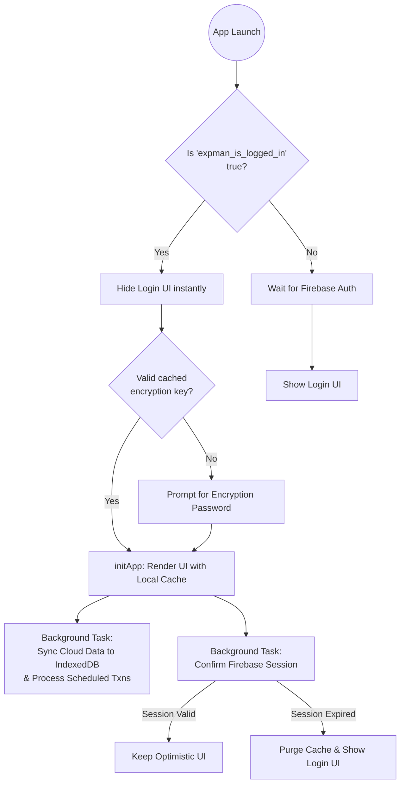

# Initial Login & Caching Architecture

This document explains the initialization, authentication, and caching flow of the application. The architecture is designed for **zero-wait, instant startup** for returning users by aggressively trusting local caches and performing all network operations asynchronously in the background.

## 1. App Boot & Optimistic Loading (`startAuthFlow`)

When the application loads, `startAuthFlow()` in `webapp/js/core/init.js` is triggered.
- If `USE_LOCAL_DATA` is enabled in `webapp/config.js`, Firebase is skipped completely and the app boots directly.
- Otherwise, it initializes Firebase Auth and Storage.
- **Optimistic UI:** Before waiting for Firebase Auth to initialize (which requires a network round-trip), the app checks `localStorage` for the `expman_is_logged_in` flag. 
- If `true`, it immediately hides the login screen and proceeds to the decryption flow, providing an instant visual transition.

## 2. Decryption Flow

The optimistic load instantly triggers `checkEncryptionAndUnlock()` from `encryption_manager.js`.
- It checks if a valid encryption key is already cached (e.g., in `sessionStorage` or securely in `localStorage`).
- If a key exists, the app unlocks immediately. 
- If not, the user is prompted to enter their encryption password (separate from their Firebase login password).
- Upon successful unlock, the core `initApp()` routine is fired.

## 3. Instant Local Cache Render (`initApp`)

The `initApp()` function is responsible for assembling the UI using cached data:
- `loadAllCSVs()`, `loadMetadata()`, and `loadScheduledCSV()` are called. These functions query the local **IndexedDB** cache to fetch all financial records instantly.
- The UI is rendered entirely using this offline local data.
- `initSmsFromCache()` is called to instantly populate the Add Entry page and Dashboard with pending SMS/Email transactions from the local storage cache, prior to Android pushing new ones.

## 4. Background Sync (`syncCloudDataInBackground`)

Once the UI is fully rendered and interactive, network requests begin strictly in the background:
- `syncCloudDataInBackground()` connects to Firebase Storage.
- It compares the eTags or timestamps of remote files against the local cache.
- If newer data exists on the cloud (e.g., modified from another device), it downloads, decrypts, and updates the local IndexedDB cache, silently re-rendering the UI.
- **Scheduler Execution:** During this sync, it also invokes `processScheduledTransactions()` to evaluate and auto-post any due recurring transactions before saving to the cloud.
- `startBackgroundRefresh()` initializes a 5-minute polling interval to continually sync the local cache with the cloud while the app remains open.

## 5. Manual Sync (Pull-to-Refresh)

On mobile devices, users can manually trigger a cache invalidation check via a native-feeling "Pull-to-Refresh" gesture on the dashboard.
- This bypasses the 5-minute polling interval and immediately invokes `syncCloudDataInBackground()`.
- The UI handles the touch gesture physics natively via `helpers.js` and provides visual feedback via a spinner that dynamically tracks the scroll gap.
- Once the background sync completes (resolving new eTags/timestamps), the UI updates seamlessly.

## 6. Late Auth Confirmation

Eventually, the Firebase `onAuthStateChanged` callback fires:
- **Success:** If the optimistic load was correct (the user has a valid Firebase session), it simply updates the UI with the user's email (e.g., in the sidebar).
- **Failure:** If the session is invalid or expired (meaning the `onAuthStateChanged` returns a `null` user), the app detects that the optimistic load was a false positive. It immediately purges all `expman_*` keys from `localStorage` and reloads the page to safely present the login screen.

## Advantages of this Flow
1. **Instant UX:** The user never stares at a loading spinner waiting for Firebase Auth or Cloud Storage on a cold start.
2. **Offline-First:** The app functions perfectly offline based on the last known IndexedDB state.
3. **Eventual Consistency:** Background sync ensures the data is eventually consistent across all devices without blocking the main thread.
