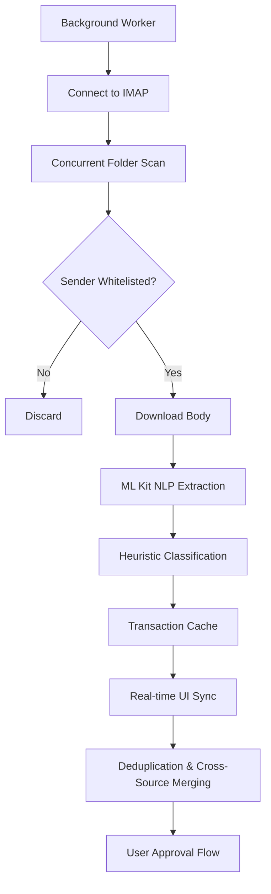
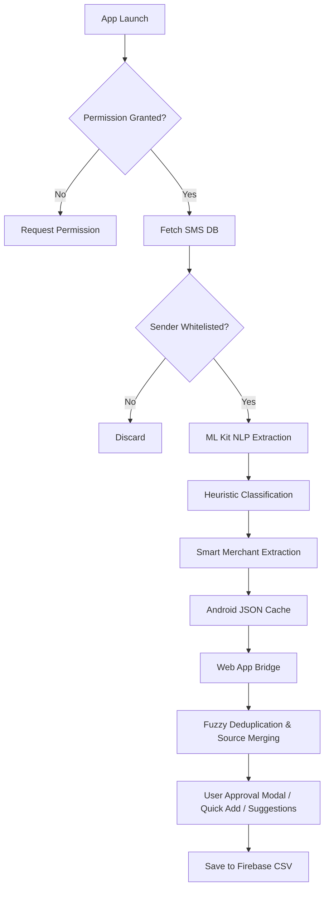

# Email Transaction Analysis - Architecture

This document outlines the architectural approach for extracting transaction data from Gmail directly within the Android application.

## Approach: Native Android IMAP Client

This approach uses a background worker (`EmailProcessor.kt`) that connects directly to the user's Gmail via the IMAP protocol using `jakarta.mail`. It runs silently in the background when the app is opened and extracts transactions.

### 1. Authentication & Connection
- Connects to `imap.gmail.com` using SSL over port 993.
- Authentication is handled via a **Google App Password** securely stored in the Android Keystore/SharedPreferences. Generate one at: https://myaccount.google.com/apppasswords
- **Credential Cloud Sync**: IMAP credentials (email + app password) are consolidated in `<userEmail>/user_settings.json` under the `"gmail"` namespace for cross-device restoration.
  - **Save**: When a user links a Gmail account via the Android app, `saveGmailCredentialsToCloud()` in `webapp/js/services/gmail.js` updates `user_settings.json.gmail`.
  - **Load**: On app launch, `loadGmailCredentialsFromCloud()` checks `user_settings.json` for stored credentials and restores them to the Android app via `WebAppInterface.saveImapCredentials()`.
  - **Auto-upload**: If no credentials exist in `user_settings.json` but local credentials are found on the device, they are automatically saved to `user_settings.json`.
  - **Delete**: When the user unlinks Gmail, `deleteGmailCredentialsFromCloud()` removes the `"gmail"` namespace from `user_settings.json`.
  - **Encryption**: Stored unencrypted within `user_settings.json` (which is excluded from file-level encryption).
- **Concurrent Scanning**: Connects and scans multiple folders (`"[Gmail]/All Mail"` and `"[Gmail]/Spam"`) entirely in parallel using Kotlin `async` coroutines to slash IMAP network time in half.
- **Message Limiting**: To prevent infinite scrolling over massive inboxes, the engine bounds its search strictly to the last 100 recent messages per folder (or 7 days).
- **First Scan Backfilling**: If the app detects no existing transaction cache (a "first scan"), it dynamically upgrades the search limits to an extensive 60 days and 500 messages (configurable) to heavily backfill the user's historical transactions, then drops down to the lighter limits for all future background syncs.

### 2. Data Fetching & Caching
- **Timestamp Caching**: To minimize network usage, it stores `last_email_scan_time` in `SharedPreferences`. On subsequent runs, it halts the backward scan as soon as it hits an email older than this timestamp.
- **Cache Hit Short-circuiting**: To further guarantee idempotency and speed up scans, the processor creates a highly optimized `Set` of all previously cached transaction timestamps. If it encounters a new potential transaction email and its timestamp already exists in the cache, the IMAP loop is instantly broken (since scanning reversed messages means all older messages are also cached).
- **False Positive Pre-Filtering**: Before undertaking an expensive network fetch to download an email's body, the app instantly filters out known high-frequency non-transactional senders (e.g., statements, booking tickets) via a strict hardcoded whitelist.
- **Batch Processing & Memory Management**: During large inbox scans, ML Kit Extraction tasks are batched. Every 100 messages (`syncBatchSize`), the background thread stops, `awaits` all pending machine learning tasks, saves progress, and flushes memory to prevent thousands of unresolved promises from crashing the app.
- **Transaction Cache**: Extracted transactions are stored in a local JSON cache (`email_cache_json`) managed by `TransactionCache.kt`.

### 3. NLP Extraction Pipeline & Filtering
- **Recursive MIME Parsing**: `getTextFromMessage` in `EmailProcessor.java` recursively traverses nested `multipart/*` payloads (such as `multipart/mixed` containing nested `multipart/alternative`), ensuring HTML/plain-text bodies are fully unpacked across all email clients.
- **Payment Reminder & Bill Due Filtering**: Before parsing transaction data, the system evaluates `TransactionUtils.isTransactionEmail(subject, body)` and `TransactionUtils.isReminderOrNonTransaction(subject, body)` against `AppConfig.REMINDER_KEYWORDS` (e.g. `reminder`, `payment reminder`, `is due`, `due on`, `due date`, `overdue`, `upcoming bill`). Messages matching reminder/due patterns without explicit transaction completion confirmation (e.g., `was successful`, `debited`, `credited`, `sent Rs`) are classified as payable bills/reminders and are skipped from transaction logging.
- **ML Kit Annotation & Promotional Amount Exclusion**: Passes the body to Google ML Kit's `EntityExtractor` to accurately extract monetary values and currencies. It filters out promotional offer limits/discounts/cashback caps (e.g., `upto ₹50`, `cashback upto ₹50`, `flat ₹50 off`, `₹100 saved`) using `TransactionUtils.isPromoAmountInText(...)` and regex patterns (`PROMO_AMOUNT_PREFIX`, `PROMO_AMOUNT_SUFFIX`), selecting the true bill or transaction amount.
- **Explicit Total Amount Extraction**: `TransactionUtils.extractValidAmount(body)` uses `EXPLICIT_TOTAL_AMOUNT_REGEX` to prioritize explicit invoice total lines (e.g., `Paid Via Credit/Debit card ₹396`, `Total Paid ₹396`, `Grand Total ₹396`) before scanning itemized breakdown numbers.
- **Dynamic Merchant & Category Mapping**: `CategoryMapper.kt` scans full message text (`subject + "\n" + body`) for dynamic merchants (`to Blinkit`, `to VPA blinkit104020.rzp@rxairtel Blinkit`, `paid to MILAN`, `paid on Amazon.in`). For VPA handles, it parses out friendly display names (`Blinkit`) and strips VPA extensions/IDs. If a dynamic merchant is found (e.g., `Milan`), its category is evaluated against `keywordToCategory`. If unmapped, category defaults to `Others` rather than inheriting generic gateway categories (`Amazon`, `HDFC`, `Bank Transfer`).

- **Transaction Mode Detection**: `TransactionModeMapper.kt` matches specific payment modes (`UPI`, `Card` via `credit card`/`debit card`/`paid via card`, `Meal Card`, `Bank Transfer`).
- Extracts standard fields: Amount, Date, Merchant, and Category (via `CategoryMapper.kt`).
- The `source` field cleanly extracts just the sender's email address.

### 4. UI Integration & Deduplication
- **Instant Display**: On app launch, `MainActivity` immediately pushes the cached email transactions to the web UI.
- **Real-Time Streaming & Batch Updates**: The background sync streams updates dynamically. The exact millisecond a new transaction is fully extracted and mapped, the background worker silently triggers a UI push to the WebView. Furthermore, regular batch syncs ensure the UI is fully updated every 100 messages even if no transactions were found in that batch.
- **Decoupled Async Updates & Deduplication**: Merges newly found transactions. If the exact same transaction triggers both an Email and an SMS (or notifications from multiple apps), the UI intelligently collapses them into a single pending transaction button, appending their sources together (e.g., "Email & SMS") to prevent duplicate data entry and user fatigue. Deduplication compares the **absolute** amounts to gracefully handle cases where one source (e.g., an Email receipt) mistakenly classifies a bill payment as a refund while the other (e.g., SMS) correctly classifies it as an expense.
- **Cache-Synchronous Deduplication**: To prevent visual glitches (where a newly added manual transaction temporarily reappears as a "Quick Add" suggestion when the app refreshes), the JavaScript logic synchronously updates the `localStorage` and `Android.writeLocalCsv` caches the exact moment a file is uploaded to the cloud. This ensures the deduplicator always has the absolute freshest state of existing expenses, even before the background cloud sync finishes fetching the latest CSVs from Firebase.
- **Automatic Cross-Source Source & Txn ID Merging**: When analyzing incoming SMS/Email transactions in the web app background sync (`recomputePendingSmsTransactions`), if a transaction matches an existing committed transaction (`state.expenses`) or another pending item (where amount matches within `SMS_DEDUPLICATION_THRESHOLD` and transaction dates are within a configurable date window defined by `SMS_DEDUPLICATION_WINDOW_DAYS`, defaulting to 3 days), the system automatically enriches the committed transaction by appending the new `source` (e.g. `Email: alerts@hdfcbank.net`) and new `txnId` (e.g. combining `ORDER-405-1234567-890|126917882958`). Before merging, the system verifies that the real transaction ID does not already exist on any other transaction (`isTxnIdInOtherTxn`), and prioritizes exact real Txn ID matches (`hasMatchingTxnId`) over candidate date-window matches. This cross-source enrichment occurs silently without requiring user approval, preventing duplicate pending modal prompts while preserving full transaction audit trails across order receipts and bank alerts.
- **Cache Sync & eTag Validation Safety**: To prevent eTag validation errors (`CONFLICT_DETECTED`) during file uploads while cloud sync is actively downloading CSV files, committed transaction enrichment updates `state.expenses` in memory immediately so UI reflects updates, while deferring cloud file uploads (`saveYearCSV`) in `state.pendingEnrichedYears` while `state.cloudSyncInProgress` is `true`. The moment background cloud sync completes (`state.cloudSyncInProgress === false`), `syncCloudDataInBackground` triggers `window.recomputePendingSmsTransactions()`, safely uploading the enriched committed transactions to Firebase Storage with fresh eTags (`state.fileHashes`).
- **Historical Category Learning**: When rendering these transactions for approval, if the initial NLP scan falls back to the default "Others" category, the system scans the user's historical database. By strictly matching the parsed `Merchant` name against the `Note` field of past transactions, it tallies historical category usage and automatically defaults to the user's most frequently assigned category for that merchant.
- **Cloud Sync Parameter Safety**: When `saveYearCSV(year)` is invoked after enriching existing approved expenses during SMS/Email deduplication, it collects the explicit 4-digit year string of all affected transactions to ensure year-bound cloud file sync and prevent unparameterized file uploads (e.g. `undefined.csv`).

### 5. Advantages
- **Native Integration**: Requires no external scripts or manual cron jobs.
- **Real-Time Responsiveness**: The combination of real-time streaming updates, concurrent `async` IMAP scans, and sender-whitelisting makes the UX feel instantaneous.
- **High Accuracy**: Email receipts usually contain explicit Merchant names (e.g., Swiggy, Uber) compared to obscure SMS banking alerts.

---

# SMS Transaction Analysis - Code Flow

This document outlines the architectural flow and data pipeline for how the Android application reads, filters, and structures SMS messages into valid transactions.

## 1. Trigger & Permissions (`MainActivity.kt`)
- The flow initiates when the main UI loads (`onCreate` / `onResume`).
- `MainActivity` checks for the required `android.permission.READ_SMS` permission.
- If the permission is not granted, the app launches an `ActivityResultContracts` request to prompt the user.
- Upon successful permission grant, execution is handed over to the `SmsProcessor.kt` class via `smsProcessor.initializeAndRead(context)`.

## 2. NLP Initialization (`SmsProcessor.kt`)
- The `SmsProcessor` instantiates Google ML Kit's `EntityExtractor` (configured for English).
- It verifies if the ~20MB NLP language model is available locally on the device. If not, it triggers a background download (`downloadModelIfNeeded()`).
- The pipeline yields until the model is successfully downloaded and ready for offline inference.

## 3. Data Fetching & Time Filtering
- Using the Android `ContentResolver`, the app queries the device's SMS database (`content://sms/inbox`).
- **Database-Level Filter**: A SQL `selection` clause (`date >= ?`) is applied immediately. The app queries the `last_sms_scan_time` from `SharedPreferences` to fetch only new messages received since the last successful sync.
- **Transaction Cache**: Previously parsed SMS transactions are stored in a local JSON cache (`sms_cache_json`). New messages are parsed and appended to this cache, dropping anything older than 30 days to save space.

## 4. Sender Whitelisting
- For each message returned by the cursor, the sender's `address` is converted to uppercase.
- It is checked against a whitelisted array of `SmsConfig.senderKeywords` (e.g., `HDFCBK`, `SWIGGY`, `AMAZON`).
- Messages from unknown senders are discarded early to save processing power.

## 5. NLP Extraction Pipeline
- The raw `body` of whitelisted messages is passed into the ML Kit `entityExtractor.annotate()` function.
- The pipeline iterates through the resulting annotations searching for `Entity.TYPE_MONEY`.
- **Balance Overwrite Protection**: The loop deliberately breaks after finding the *first* valid monetary entity, capturing it as the transaction amount. This prevents trailing text (like "Available Balance: INR 5000") from overwriting the actual spent amount.

## 6. Heuristic Classification & Thresholding
- **Type Detection**: A lightweight heuristic scan checks the lowercase message body for keywords like `"credited"`, `"received"`, or `"added"`. If found, it marks the transaction as a `Credit`. Otherwise, it defaults to a `Debit`.
- **Amount Adjustments**: If the transaction is classified as a `Credit`, the extracted amount is negated (turned negative) to represent an influx of funds (refunds or income), adhering to the standard internal representation.
- **Transaction ID Extraction**: A regex heuristic scans for reference numbers following patterns like `Ref No`, `Txn`, `UPI Ref`, or `URN`. The extracted ID and sender are compiled into a strict note format: `SMS: <sender> | Ref: <txnid>`.
- **Exclusion**: Transactions with numeric amounts falling below `AppConfig.Sms.minAmountToLog` (default 10.0) are discarded.

## 7. Smart Merchant Extraction (Zero Configuration)
- `CategoryMapper.kt` scans the SMS sender ID and body against a dictionary of popular merchant keywords (e.g., `"swiggy"`, `"netflix"`).
- It utilizes word-boundary regular expressions (`\bkeyword\b`) to prevent false-positive partial matches (e.g., preventing "vi" from matching inside the word "via").
- It extracts a `Pair(Merchant, MasterCategory)` (e.g., `Merchant = "Swiggy"`, `MasterCategory = "Food"`). If no match is found, it defaults to `"Others"`.
- Both fields are attached to the `SmsTransaction` payload.

## 8. Web App Bridge & UI Updates
- **Instant Display**: On app launch, `MainActivity` immediately retrieves the `sms_cache_json` and pushes it to the web view via `window.receiveSmsTransactions()`.
- **Decoupled Async Updates**: The actual SMS database scan runs in the background. If it discovers *new* SMS messages, it updates the cache and pushes a fresh, combined payload to the UI without blocking other background workers (like the Email sync).
- **Normalized Cache Key Overwriting**: `mergeRawTransactions` constructs a normalized lookup key (`date_absAmount_cleanSource`) using `Math.abs(amount)`. This ensures that when Android rescans after a cache wipe or payload update, incoming fresh credit payloads (`amount < 0`, `txnType: 'Income'`) correctly overwrite stale cached items regardless of sign mismatches in earlier cached versions.
- **Unclassified Credit Type Fallback**: For incoming transactions without an explicit `txnType`, negative amounts (`amount < 0`) default to `getTxnTypeForMerchant(merchant, 'Income')` rather than defaulting to `Refund`.
- **Transaction Mode Mapping**: Incoming `transactionMode` strings from Android (e.g. `"Meal Card"`, `"UPI"`, `"Card"`, `"Bank Transfer"`) are processed through `mapTxnMode(rawMode, state.txnModes)`. This strips emoji prefixes and matches exact or partial names against the user's active payment mode chips (e.g. mapping `"Meal Card"` to `"🍱 Meal Card"`).
- **Fuzzy Deduplication & Source Merging**: The web application compares incoming SMS transactions against the existing database. To handle minor discrepancies, it applies a `+/- SMS_DEDUPLICATION_THRESHOLD` (default 1 Rupee) match on the `amount` and a configurable date window (`SMS_DEDUPLICATION_WINDOW_DAYS`, defaulting to 3 days). Furthermore, it deduplicates pending transactions that arrive from multiple sources (e.g., Gmail and an SMS, or Swiggy and Amazon Pay) into a single unified button for the user to approve, gracefully combining their `source` labels (e.g., "SMS & Email") and transaction IDs (e.g. `ORDER_123|HDFC_456`) to reduce notification fatigue.
- **Committed Transaction Cross-Source Enrichment**: When analyzing raw SMS/Email transactions in background sync (`recomputePendingSmsTransactions`), any matching committed expense in `state.expenses` is automatically enriched in memory with new sources and transaction IDs without requiring user approval, preventing duplicate suggestions across the UI.
- **Cache Sync & eTag Validation Safety**: To prevent eTag validation failures (`CONFLICT_DETECTED`) during in-flight cloud syncs, cloud CSV uploads (`saveYearCSV`) for enriched committed transactions are deferred in `state.pendingEnrichedYears` while `state.cloudSyncInProgress` is `true`. The moment background cloud sync finishes, `syncCloudDataInBackground` triggers `window.recomputePendingSmsTransactions()`, uploading the enriched CSV files with fresh eTags (`state.fileHashes`) safely.
- **Cache-Synchronous Deduplication**: To prevent visual glitches (where a newly added manual transaction temporarily reappears as a "Quick Add" suggestion when the app refreshes), the JavaScript logic synchronously updates the `localStorage` and `Android.writeLocalCsv` caches the exact moment a file is uploaded to the cloud. This ensures the deduplicator always has the absolute freshest state of existing expenses, even before the background cloud sync finishes fetching the latest CSVs from Firebase.
- **Explicit Discard Cache**: If a user explicitly discards a transaction, its signature (Date + Amount) is permanently stored in `expman_discarded_signatures`. Even if Android's 30-day SQL cache repeatedly re-sends the raw SMS, the web app will instantly drop it upon merging, ensuring dismissed ghosts never reappear.
- **Historical Category Learning**: If the Android parser fails to confidently assign a category and falls back to "Others", the web app dynamically checks the user's historical database. It strictly compares the incoming `Merchant` name against the `Note` field of all past transactions. If a match is found, it tallies up the categories used for those historical matches and automatically pre-selects the most frequently used category for the new transaction.
- **Cloud Sync Parameter Safety**: When `saveYearCSV(year)` is invoked after enriching existing approved expenses during SMS/Email deduplication, it collects the explicit 4-digit year string of all affected transactions to ensure year-bound cloud file sync and prevent unparameterized file uploads (e.g. `undefined.csv`).
- **Bulk vs Single Approval Flows**: Unseen transactions populate a modern, card-based "Pending SMS Transactions" overlay modal for bulk approval. However, the user can entirely bypass this modal by using the "Quick Add" buttons directly on the Dashboard, or by clicking the suggestions inside the Add Entry form. Single-item approvals instantly add to the `state.expenses` database, which triggers the global deduplicator to silently hide all identical incoming SMS/Email duplicates across the UI, naturally preventing double-counting without requiring bulk modal management.
