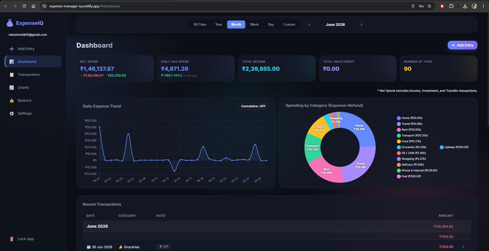
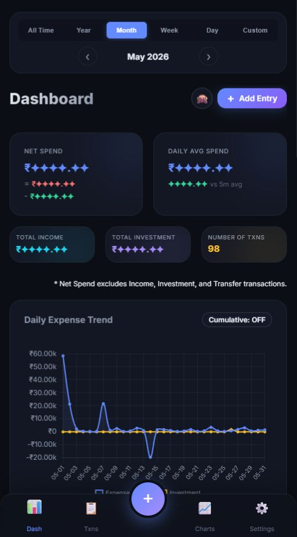

# 💰 SpendBuddy — Personal Finance Tracker

A lightweight, offline-first expense tracker built with vanilla HTML, CSS, and JavaScript, powered by a **Serverless Firebase Architecture**. Track expenses, visualize spending patterns with interactive analytics, manage recurring transactions, link refunds, track account balances, and securely sync your data across devices with client-side encryption.

 

🌐 **Live:** [https://spend-buddy.netlify.app/](https://spend-buddy.netlify.app/)

📱 **Android App (Testing):** [Google Play Store](https://play.google.com/store/apps/details?id=com.rakeshmalik.expenseiq&hl=en-US&ah=PWeYC0blBt-9ARFtnYGBJPYcB-4)

---

## ✨ Features

- **End-to-End Encryption (E2EE)** — Client-side AES-GCM encryption with zero plaintext cloud exposure.
- **Serverless Cloud Sync** — Offline-first IndexedDB caching with automatic background sync to Firebase Storage CSVs.
- **Transaction Ledger & Search** — Search and filter by category, payment mode, tags, and geolocation with multi-column sorting.
- **Refund Linking** — Automatically groups refunds with original expenses and calculates net totals with collapsible sub-rows.
- **Balance & Net Worth Tracker** — Historical pivot table, account grouping, and stacked asset/liability trajectory charts.
- **Scheduled Transactions** — Manage recurring income and expenses with automated execution.
- **SMS & Email Inbox Automation** — Companion Android app extracts bank alerts via ML Kit NLP for 1-click recording.
- **Math Expressions in Amount Inputs** — Evaluates live arithmetic calculations directly in the amount field (`127+100+30`).
- **Interactive Visualizations** — 12+ Chart.js visual analytics with time-series trends and custom breakdowns.
- **Multi-Device Responsive UI** — Dark glassmorphic design optimized for desktop, tablets, mobile browsers, and Android WebViews.

---

## 📸 Screenshots

<p align="center">
  &nbsp;&nbsp;
  
</p>

---

## 🛠️ Local Development Setup

### Prerequisites
- A modern web browser
- Node.js (v16+) and npm
- A local HTTP server (e.g., VS Code Live Server, or `npx http-server`)

### 1. Clone the repository
```bash
git clone https://github.com/rakeshmalik91/spendbuddy.git
cd spendbuddy
```

### 2. Unlock Encrypted Data (git-crypt)
Sensitive user data (`data/` folder and `sync.bat`) is encrypted with [git-crypt](https://github.com/AGWA/git-crypt).

If you are the repository owner or have the secret key:
1. Ensure `git-crypt` is installed on your machine (`brew install git-crypt`, `choco install git-crypt`, or via Scoop/binary).
2. Unlock the repository with your key:
   ```bash
   git-crypt unlock /path/to/expenseiq-git-crypt.key
   ```
   All encrypted CSV files and scripts will instantly become plain text.

> [!NOTE]
> Public contributors can run and develop the app without `git-crypt` by running in local demo mode or connecting to their own Firebase instance.

### 3. Configure Firebase (Optional)
By default, the application connects to the project's Firebase instance defined in `webapp/config.js`. If you wish to use your own Firebase backend:
1. Open `webapp/config.js`.
2. Update `FIREBASE_CONFIG` with your Firebase project credentials (`apiKey`, `authDomain`, `projectId`, `storageBucket`, etc.).

### 4. Start Local Server
The app must be served over HTTP due to CORS and ES Modules.
```bash
npm run dev
# or: npx -y http-server webapp -p 8080 -c-1
```
Open `http://localhost:8080` in your browser.

### 5. Adding a New Domain (CORS / Auth)
If you are accessing the app from a different device on your network (e.g., `http://192.168.x.x:8080`), you need to whitelist the domain in Firebase:
1. **Update CORS Configuration**: Open `webapp/cors.json` and add your domain to the `origin` array.
2. **Apply Storage Rules**: Run the following command to deploy the updated CORS rules to your Firebase Storage bucket:
   ```bash
   gsutil cors set webapp/cors.json gs://<your-bucket-url>
   ```
3. **Update Firebase Authentication**: Go to the **Firebase Console** > **Authentication** > **Settings** > **Authorized domains** and add your IP address or domain.

### 6. Running Tests

#### Run All Tests (Frontend Jest + Android Gradle)
```bash
npm run test:all
```
Or on Windows PowerShell:
```powershell
.\run_all_tests.ps1
```

#### Run Web Frontend Tests Individually
The web frontend includes a comprehensive Jest unit test suite covering state, storage, encryption, UI builders, helpers, and expressions:
```bash
npm test
# or from webapp directory:
cd webapp && npm test
```

#### Run Android Companion App Tests Individually
The companion Android app (`spendbuddy-android-app`) includes JUnit tests for ML Kit entity extraction, transaction mapping, and SMS regex parsing:
```bash
cd spendbuddy-android-app
./gradlew test
```
To view detailed test output:
```bash
./gradlew test --info
```
Test reports are generated in `spendbuddy-android-app/app/build/reports/tests/testDebugUnitTest/index.html`.

---

## 📁 Project Structure

```
spendbuddy/
├── webapp/                # Web application frontend (modular single-page app)
│   ├── index.html         # Single-page application markup & modals
│   ├── app.js             # Frontend application bootstrap entry
│   ├── config.js          # Firebase configuration & app settings
│   ├── cors.json          # Firebase Storage CORS configuration rules
│   ├── firebase-rules     # Firebase Storage security rules
│   ├── privacy-policy.html# Privacy policy for Google Play listing
│   ├── css/               # Modular CSS architecture (base, components, layout, views)
│   ├── js/                # Modular ES6 JavaScript architecture (core, services, ui, utils)
│   ├── tests/             # Jest unit test suite (18+ test suites)
│   ├── package.json       # Web application package definition & Jest dependencies
│   └── package-lock.json  # Web application locked dependency tree
├── spendbuddy-android-app/ # Android companion app (Kotlin, ML Kit entity extraction, SMS processing)
├── data/                  # Shared data folder: synced user CSV data (git-crypt) & test-data
├── media/                 # Screenshots, icons, and graphic assets
├── utils/                 # Development and helper tools (sync.py, download_emails.py)
├── docs/                  # System architecture guides & technical documentation
│   ├── README.md          # Master architecture index & documentation map
│   └── architecture/      # Deep-dive subsystem architecture specifications
├── netlify.toml           # Netlify build & deployment configuration
├── run_all_tests.ps1      # PowerShell test runner for both Web and Android
├── run.bat                # Quick-launch local web dev server
├── sync.bat               # Automated local Firebase CSV synchronization
├── package.json           # Root workspace scripts & orchestration
└── README.md
```

---

## 📖 Documentation & Architecture

Comprehensive architectural specifications and decision records are maintained in [`docs/`](docs/README.md):
- [Virtual Keyboard Viewport & Sticky Headers](docs/architecture/virtual-keyboard-viewport.md)
- [Transaction Table & Mobile Card Layouts](docs/architecture/txn-table-ui.md)
- [Refund Merging & Sub-Rows](docs/architecture/refund-linking.md)
- [Balance & Net Worth Tracker](docs/architecture/balance-tracker.md)
- [Amount Math Expression Evaluator](docs/architecture/expression-as-amount.md)
- [Google Drive Automated Periodic Backups](docs/architecture/google-drive-backup.md)
- [Custom Keyword Mappings & Inference Engine](docs/architecture/keyword-mappings.md)
- [Zero-Wait Login, Auth & Offline Caching](docs/architecture/login-and-caching.md)
- [SMS & Email Inbox Extraction Pipeline](docs/architecture/sms-email-analysis.md)

---

## 💻 Tech Stack

| Technology / Library | Purpose |
|---|---|
| [Firebase JS SDK](https://firebase.google.com/) | Cloud Storage CSV sync & Authentication |
| [Chart.js 4.x](https://www.chartjs.org/) | Interactive data visualizations & trend charts |
| [Chart.js Datalabels Plugin](https://chartjs-plugin-datalabels.netlify.app/) | In-chart value labels and annotations |
| [Papa Parse 5.x](https://www.papaparse.com/) | Client-side CSV parsing & serialization |
| [Web Crypto API](https://developer.mozilla.org/) | Client-side AES-GCM zero-knowledge encryption |
| [Jest](https://jestjs.io/) & [Babel](https://babeljs.io/) | Frontend unit testing suite |
| [Android SDK / Kotlin](https://developer.android.com/) | Companion Android app with SMS processing & ML Kit |
| Vanilla HTML5 / CSS3 / ES6 JS | Modular zero-bundler single-page frontend |

---

## 📝 License

MIT — free for personal and commercial use.

