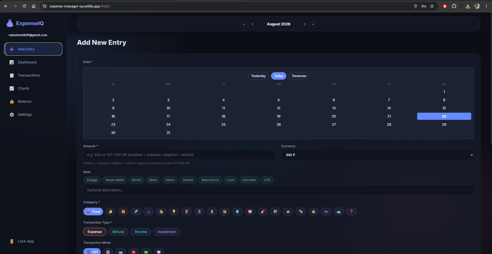
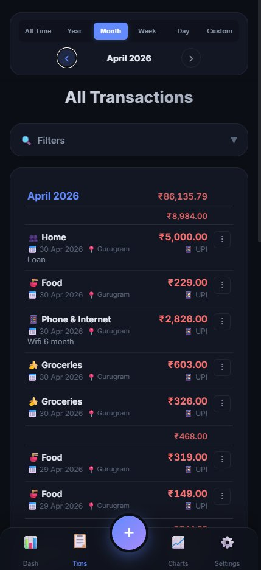
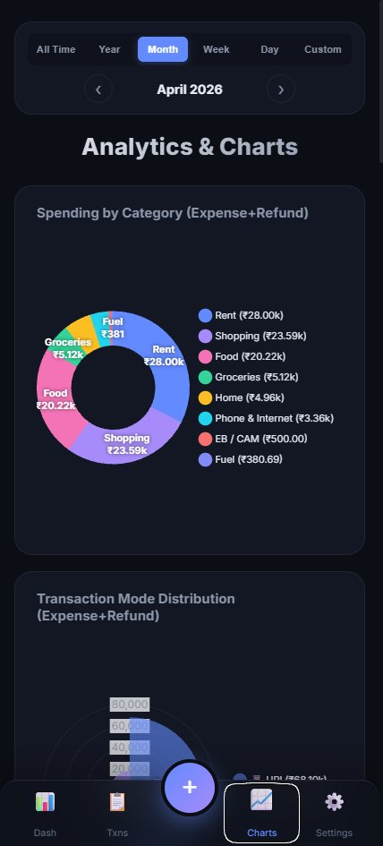
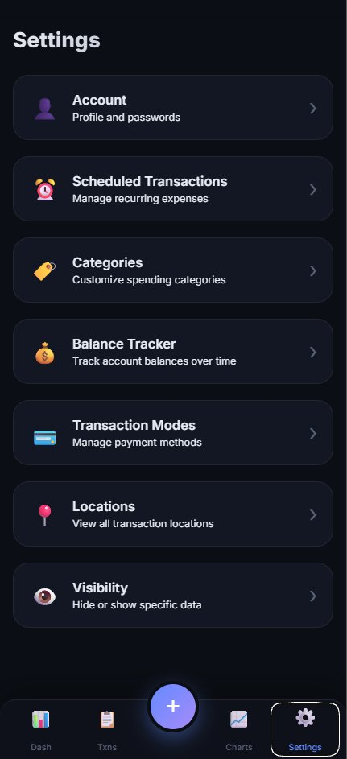
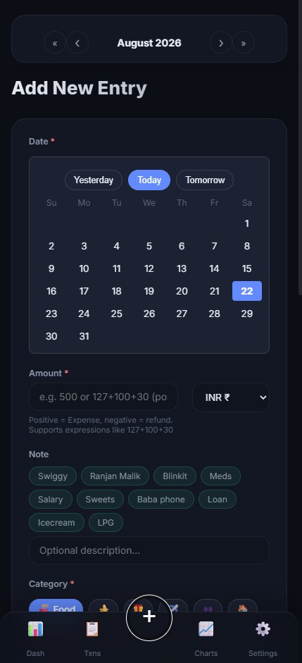

# 💰 ExpenseIQ — Personal Finance Tracker

A lightweight, offline-first expense tracker built with vanilla HTML, CSS, and JavaScript, powered by a **Serverless Firebase Architecture**. Track expenses, visualize spending patterns with interactive analytics, manage recurring transactions, link refunds, track account balances, and securely sync your data across devices with client-side encryption.

   

🌐 **Live:** [https://expense-manager-iq.netlify.app/](https://expense-manager-iq.netlify.app/)

📱 **Android App (Testing):** [Google Play Store](https://play.google.com/store/apps/details?id=com.rakeshmalik.expenseiq&hl=en-US&ah=PWeYC0blBt-9ARFtnYGBJPYcB-4)

---

## ✨ Features

- **Serverless Cloud Sync & ETag Caching** — Reads and writes raw CSV data (`data.csv`, `balance.csv`, `metadata.csv`, `scheduled_transaction.csv`, `user_settings.json`) directly to Google Firebase Storage with offline ETag caching and background sync.
- **Client-Side End-to-End Encryption** — Uses the Web Crypto API (AES-GCM) to physically encrypt your data with your master passcode. The app cannot boot without the passcode when E2EE is enabled.
- **Dashboard & Timeline Granularity** — Real-time summary cards (Income, Expense, Net Balance, Transaction count), timeline filters (All, Year, Month, Week, Day), monthly expense trend charts, category donuts, and quick recent transaction lists.
- **Transactions Management** — Full-featured interactive transaction ledger with multi-column sorting, text search, and multi-criteria filters (time range, category, payment mode, transaction type, tag, location).
- **Refund Tracking & Linking** — Parent-child transaction relationship linking. Refunds automatically attach to their original expense transactions with collapsible sub-rows and net expense calculations.
- **Account Balance Tracker** — Comprehensive account balance ledger tracking opening and closing balances, daily reconciliations, and historical balance trajectory charts.
- **Scheduled & Recurring Transactions** — Create and manage recurring income/expense schedules (daily, weekly, monthly, yearly) with automatic calculation of next due dates.
- **Smart Tagging & Location Analytics** — Support for custom `#tags` and geographic location logging per transaction, with dedicated spending analytics breakdowns.
- **Math Expressions in Amount Inputs** — Evaluates live arithmetic expressions directly inside the amount field (e.g., `1200 + 450 * 2`).
- **Batch Update** — Bulk modify categories, payment modes, transaction types, dates, tags, and locations across multiple transactions simultaneously.
- **SMS & Email Inbox Automation** — Companion Android app parses bank SMS alerts and emails using ML Kit entity extraction and regex, offering an approval inbox flow for 1-click recording.
- **12+ Interactive Charts & Visualizations** — Deep spending analytics with Chart.js, customizable granularity, and cumulative / chart type toggling.
- **Dark Glassmorphism UI & Touch Navigation** — Responsive design tailored for desktop, mobile browsers, tablets (split-screen/iPad), and native Android WebViews with smooth swipe gesture navigation.

---

## 📸 Screenshots

### Desktop Views
<p align="center">
  
  
</p>

### Mobile App Views
<p align="center">
  
  
  
  
  
</p>

---

## 🛠️ Local Development Setup

### Prerequisites
- A modern web browser
- Node.js (v16+) and npm
- A local HTTP server (e.g., VS Code Live Server, or `npx http-server`)

### 1. Clone the repository
```bash
git clone https://github.com/rakeshmalik91/expense-manager.git
cd expense-manager
```

### 2. Unlock Encrypted Data (git-crypt)
Sensitive user data (`data/` folder and `sync.bat`) is encrypted with [git-crypt](https://github.com/AGWA/git-crypt).

If you are the repository owner or have the secret key:
1. Ensure `git-crypt` is installed on your machine (`brew install git-crypt`, `choco install git-crypt`, or via Scoop/binary).
2. Unlock the repository with your key:
   ```bash
   git-crypt unlock /path/to/expenseiq-git-crypt.key
   ```
   All encrypted CSV files and scripts will instantly become plain text.

> [!NOTE]
> Public contributors can run and develop the app without `git-crypt` by running in local demo mode or connecting to their own Firebase instance.

### 3. Configure Firebase Keys
You must encrypt your Firebase keys before the app will run:
1. Open `utils/encrypt_config.html` in your browser.
2. Paste your raw Firebase JSON configuration and your chosen passcode.
3. Click **Encrypt** and save the resulting file directly over `config.js`.

### 4. Start Local Server
The app must be served over HTTP due to CORS and ES Modules.
```bash
npx -y http-server -p 8080 -c-1
```
Open `http://localhost:8080` in your browser.

### 5. Adding a New Domain (CORS / Auth)
If you are accessing the app from a different device on your network (e.g., `http://192.168.x.x:8080`), you need to whitelist the domain in Firebase:
1. **Update CORS Configuration**: Open `cors.json` and add your domain to the `origin` array.
2. **Apply Storage Rules**: Run the following command to deploy the updated CORS rules to your Firebase Storage bucket:
   ```bash
   gsutil cors set cors.json gs://<your-bucket-url>
   ```
3. **Update Firebase Authentication**: Go to the **Firebase Console** > **Authentication** > **Settings** > **Authorized domains** and add your IP address or domain.

### 6. Running Tests

#### Run All Tests (Frontend Jest + Android Gradle)
```bash
npm run test:all
```
Or on Windows PowerShell:
```powershell
.\run_all_tests.ps1
```

#### Run Web Frontend Tests Individually
The web frontend includes a comprehensive Jest unit test suite covering state, storage, encryption, UI builders, helpers, and expressions:
```bash
npm install
npm test
```

#### Run Android Companion App Tests Individually
The companion Android app (`expenseiq-android-app`) includes JUnit tests for ML Kit entity extraction, transaction mapping, and SMS regex parsing:
```bash
cd expenseiq-android-app
./gradlew test
```
To view detailed test output:
```bash
./gradlew test --info
```
Test reports are generated in `expenseiq-android-app/app/build/reports/tests/testDebugUnitTest/index.html`.

---

## 📁 Project Structure

```
expense-manager/
├── index.html             # Single-page application markup & modals
├── app.js                 # Frontend application bootstrap entry
├── config.js              # Encrypted Firebase credentials configuration
├── cors.json              # Firebase Storage CORS configuration rules
├── firebase-rules         # Firebase Storage security rules
├── privacy-policy.html    # Privacy policy for Google Play listing
├── css/                   # Modular CSS architecture
│   ├── base/              # Global CSS tokens, reset, typography
│   ├── components/        # Buttons, cards, filters, forms, modals, tables, toasts
│   ├── layout/            # App shell, header, sidebar navigation, responsive grids
│   └── views/             # View-specific styles (e.g., settings, balance)
├── js/                    # Modular ES6 JavaScript architecture
│   ├── core/              # Initialization, reactive state management
│   ├── services/          # Firebase Auth/Storage, ETag caching, Encryption, Gmail API
│   ├── ui/                # UI controllers (Dashboard, Transactions, Charts, Balance, Modals, Forms)
│   └── utils/             # Helper utilities, math expressions, swipe navigation, crypto
├── tests/                 # Jest unit test suite (18+ test suites)
├── scripts/               # Automation scripts (e.g., run_all_tests.js)
├── utils/                 # Development and helper tools (sync.py, download_emails.py, encrypt_config.html)
├── expenseiq-android-app/ # Android companion app with SMS processing & ML Kit
└── media/                 # Screenshots, icons, and graphic assets
```

---

## 💻 Tech Stack

| Technology / Library | Purpose |
|---|---|
| [Firebase JS SDK](https://firebase.google.com/) | Cloud Storage CSV sync & Authentication |
| [Chart.js 4.x](https://www.chartjs.org/) | Interactive data visualizations & trend charts |
| [Chart.js Datalabels Plugin](https://chartjs-plugin-datalabels.netlify.app/) | In-chart value labels and annotations |
| [Papa Parse 5.x](https://www.papaparse.com/) | Client-side CSV parsing & serialization |
| [Web Crypto API](https://developer.mozilla.org/) | Client-side AES-GCM zero-knowledge encryption |
| [Jest](https://jestjs.io/) & [Babel](https://babeljs.io/) | Frontend unit testing suite |
| [Android SDK / Kotlin](https://developer.android.com/) | Companion Android app with SMS processing & ML Kit |
| Vanilla HTML5 / CSS3 / ES6 JS | Modular zero-bundler single-page frontend |

---

## 📝 License

MIT — free for personal and commercial use.

