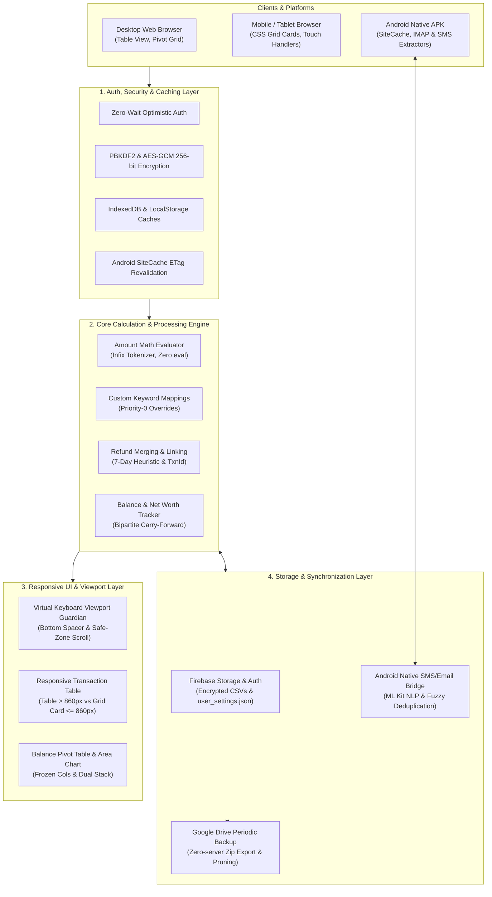

# 📚 SpendBuddy Architecture & System Documentation

Welcome to the central documentation index for **SpendBuddy**. This repository maintains deep architectural guides for both **human engineers** and **AI pair programming agents** (Antigravity, Gemini, Cursor, Copilot).

---

## 🗺️ Architecture & Subsystem Guides

| Subsystem | Architectural Guide | Description & Key Invariants |
| :--- | :--- | :--- |
| **Touch Viewports & Virtual Keyboard** | [virtual-keyboard-viewport.md](architecture/virtual-keyboard-viewport.md) | WebKit viewport pan prevention, bottom void recovery, sticky header clearance, `.form-bottom-spacer`, and dynamic focus positioning. |
| **Transaction Table & Mobile Cards** | [txn-table-ui.md](architecture/txn-table-ui.md) | Dual-layout strategy: Desktop table (`> 860px`) with tabular numeric alignment and Mobile CSS Grid card template (`<= 860px`). |
| **Refund Linking & Sub-Rows** | [refund-linking.md](architecture/refund-linking.md) | Pipe-separated `txnId` linking, net expense calculations, collapsible desktop sub-rows, and interactive multi-year linking modal. |
| **Balance & Net Worth Tracker** | [balance-tracker.md](architecture/balance-tracker.md) | Historical pivot-table grid, account/type bipartite grouping, carry-forward logic, and dual-stack (`stack: pos/neg`) area chart. |
| **Amount Expression Evaluator** | [expression-as-amount.md](architecture/expression-as-amount.md) | Live arithmetic evaluation in amount fields (`127+100+30`), regex validation, and CSV expression persistence. |
| **Google Drive Periodic Backups** | [google-drive-backup.md](architecture/google-drive-backup.md) | Client-driven periodic backups on app launch, GIS Web OAuth, multipart zip generation, and automated retention pruning. |
| **Custom Keyword Mappings** | [keyword-mappings.md](architecture/keyword-mappings.md) | Priority-0 rule engine overriding default category, type, and payment mode heuristics with batch execution on historical transactions. |
| **Login, Auth & Offline Caching** | [login-and-caching.md](architecture/login-and-caching.md) | Zero-wait optimistic login, client-side AES-GCM encryption, IndexedDB caching, and Android WebView ETag asset revalidation. |
| **SMS & Email Inbox Analysis** | [sms-email-analysis.md](architecture/sms-email-analysis.md) | Native Android IMAP + SMS reader, ML Kit NLP entity extraction, cross-source deduplication, and approval flows. |
| **Scheduled Transactions** | [scheduled-transactions.md](architecture/scheduled-transactions.md) | Recurrence scheduler, silent addition (single txn in last 3 days), modal approval (multiple / >3 days), and ETag rollback. |

---

## 🛠️ Dual-Audience Documentation Pattern

This repository follows the **"Doc-Centric + Agent-Indexed" Pattern**:

1. **For Humans (GitHub & IDEs)**:
   - All canonical technical architecture and decision records live here under `docs/architecture/`.
   - When reviewing Pull Requests or onboarding to a subsystem, read the relevant markdown guide in this directory.
   - Code files contain 1-line anchor comments pointing to these files (e.g. `/* See docs/architecture/virtual-keyboard-viewport.md */`).

2. **For AI Agents (Antigravity & Coding Assistants)**:
   - [`.agents/AGENTS.md`](../.agents/AGENTS.md) contains the **Architecture & Knowledge Index** mapping features and critical invariants directly to these canonical guides.
   - Eliminates documentation duplication, provides instant single-hop navigation, and keeps AI pair programmers perfectly aligned with architectural constraints.

---

## 🚦 Frontend Verification & Invariants

Whenever making changes to any frontend module:
- **Desktop Browsers**: Verify column constraints, dropdown menus, and sticky headers.
- **Android App**: Verify the hybrid bridge in [`spendbuddy-android-app`](../spendbuddy-android-app/).
- **Mobile & iPad Browsers**: Verify touch interactions, virtual keyboard opening/closing, and split-screen layouts.
- **Cache Bursting**: Always bump version queries in [`webapp/index.html`](../webapp/index.html) (`main.css?v=N`, `app.js?v=N`, etc.) after modifying frontend assets.
