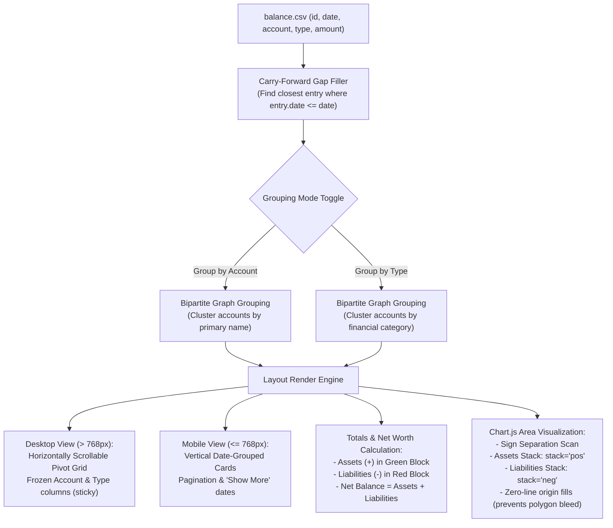
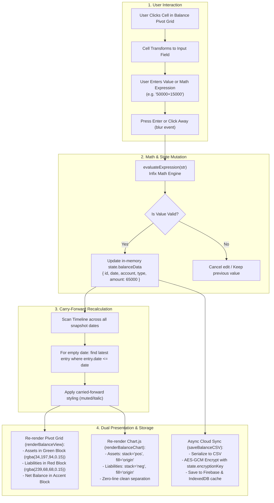

# Balance Tracker

## Overview
The Balance Tracker is a core feature of the Expense Manager designed to track net worth and account balances over time. It provides a historical pivot-table view of various financial accounts (e.g., Savings, FD, EPF, Loans, Credit Cards) mapped against specific snapshot dates, alongside a visual stacked area chart.

---

## 1. Design & UX Architecture

### 1.1 Responsive Pivot Table
The core data is presented in a pivot format where rows represent accounts (or types) and columns represent dates. 
- **Grouping Toggle**: Users can effortlessly switch between grouping accounts by **Account Name** or **Account Type**. This groups similar accounts together seamlessly via a unified Bipartite Graph algorithm.
- **Desktop View (`> 768px`)**: A robust, horizontally scrollable data grid with frozen `Account` and `Type` columns using CSS `position: sticky`. Empty dates are marked with a muted `-`.
- **Mobile View (`<= 768px`)**: A vertical, card-based layout grouped by Date. It transforms columns into vertical lists to ensure readability without horizontal scrolling.

### 1.2 Comprehensive Totals & Summaries
Instead of a simple net total, the tracker provides a detailed breakdown of your financial standing for every date column:
- **Assets (+)**: The sum of all positive balances, styled in a green-tinted block (`rgba(34, 197, 94, 0.15)`).
- **Liabilities (-)**: The sum of all negative balances (e.g., Credit Cards, Loans), styled in a red-tinted block (`rgba(239, 68, 68, 0.15)`).
- **Net Balance**: The true net worth (Assets + Liabilities), anchored on a vibrant accent block.
This distinct styling is applied to the desktop table footer, at the bottom of every date group on mobile, and within the chart tooltip.

### 1.3 Smart Stacked Area Chart (Chart.js)
A dynamic visualization built with Chart.js that plots the balance history over time.
- **Sign Separation**: The chart algorithm intelligently scans the history of each account type to determine its primary sign. It strictly separates purely positive asset classes into an upper stack (`stack: 'pos'`) and purely negative liability classes into a lower stack (`stack: 'neg'`).
- **Accurate Stacking & Filling**: This strict separation prevents visual artifacts (like positive polygons bleeding into negative polygons) and ensures that drops in liabilities (like credit card spending) are accurately reflected as downward spikes from the zero-line (`fill: 'origin'`).

---

## 2. Implementation Details

### 2.1 State & Data Structure
Data is stored securely in `balance.csv` containing the following fields:
- `id`: Unique identifier for the balance record.
- `date`: The snapshot date (`YYYY-MM-DD`).
- `account`: The name of the specific account (e.g., `HDFC`, `SBI`, `Chinu`).
- `type`: The category/type of the account (e.g., `Savings`, `FD`, `Loan`).
- `amount`: The numeric balance recorded on that date.

### 2.2 Carry-forward Logic
The table intelligently fills in missing data for dates using the most recent past entry, ensuring the total net worth calculation is always accurate.
- **Algorithm**: For any given `account` + `type` on a specific `date`, the system finds the closest entry where `entry.date <= date`.
- **Visual Distinction**: If `entry.date < date` (meaning the data is carried forward from an older snapshot), the cell is styled distinctly (e.g., muted, italicized) to indicate it was not an explicit entry for that date.

### 2.3 Inline Editing & UX
The tracker supports rapid data entry via seamless inline editing directly within the table.
- **Balance Cells**: Clicking any balance cell transforms it into an input field. Pressing `Enter` or clicking away automatically evaluates math expressions (e.g., `1000+500`), updates the local state, triggers a cloud sync, and re-renders the UI.
- **Account & Type Names**: Users can click the `Account` or `Type` names to rename them. On desktop, editing a grouped account name automatically cascades the change to all related occurrences under the hood.
- **Dynamic Columns**: Clicking the `+` button in the header adds a `NEW_COLUMN` placeholder. A native date picker appears. Once a valid, non-existing date is selected, it transforms into an editable column.

---

## 3. Testing & Maintenance Guidelines

When making changes to the Balance Tracker, strictly verify the following to prevent regressions:

### 3.1 Data Integrity & Cloud Sync
- **Inline Editing**: Ensure clicking away (`blur`) or pressing `Enter` correctly calculates the math string (if any), updates `state.balanceData`, triggers `saveBalanceCSV()`, and re-renders cleanly.
- **Empty Saves**: Editing a cell and leaving it blank should either do nothing (if unchanged) or correctly evaluate to `0`/delete the entry if supported.

### 3.2 Visual & Chart Accuracy
- **Chart Crossing Zero**: If a new account type is introduced that fluctuates heavily between positive and negative, ensure the `isPositive` sum-check in `renderBalanceChart()` adequately handles clamping it to the appropriate stack.
- **Mobile vs. Desktop Totals**: Any new logic added to the Desktop `tfoot` totals calculation MUST be mirrored in the Mobile Date-Group totals logic (located within the `window.innerWidth <= 768` block).

### 3.3 UI Responsiveness
- **Frozen Columns**: If modifying the width of the `Account` or `Type` columns, update the CSS `left` values of the frozen `<th>` and `<td>` elements (currently `left: 0` and `left: 120px` respectively) to prevent layout tearing on horizontal scroll.
- **Mobile Card View**: Verify that the "Show More" pagination logic on mobile correctly increments `window.balanceMobileShowDates` without breaking the carry-forward logic for newly revealed older dates.
