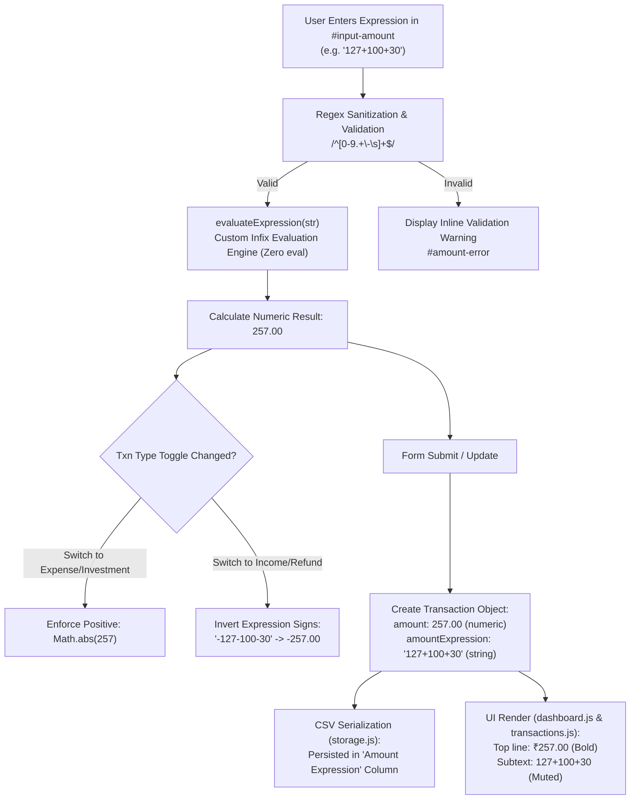
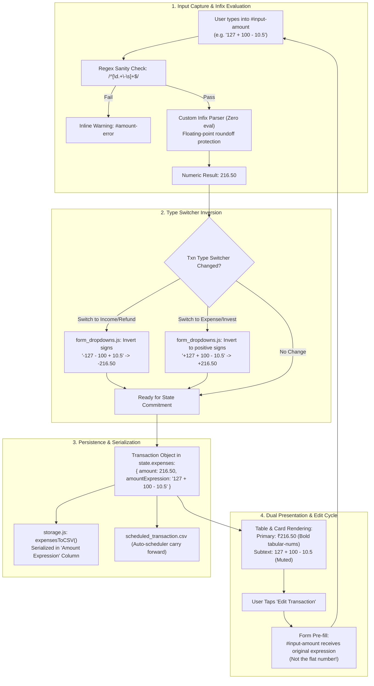

# Amount Expression Feature Architecture

## Overview
The amount field supports live mathematical expressions (e.g. `127+100+30` or `1000-50`). Instead of manually computing numbers with a calculator before entering transactions, users can enter infix arithmetic expressions directly. The application calculates the numeric total dynamically while persisting the original expression for auditability and future edits.



---

## 1. How It Works

### 1.1 Input & Live Calculation
- When adding or editing an expense, scheduled transaction, or balance entry, users can enter:
  - **Single Number**: `500` → Evaluates to `500`, stored with empty expression `""`.
  - **Addition**: `127+100+30` → Evaluates to `257.00`.
  - **Subtraction**: `1000-50` → Evaluates to `950.00`.
  - **Mixed Operations**: `500+200-30+50` → Evaluates to `720.00`.
  - **Decimals & Whitespace**: `127.50 + 100.25 - 10.00` → Evaluates to `217.75`.
  - **Refund / Income Signage**: `-500-200` or `-700+50` → Evaluates to `-700.00` or `-650.00`.

### 1.2 Display Formatting
- In table rows, mobile cards, and recent transactions:
  - **Primary Line**: The calculated total formatted as currency (e.g. `₹257.00`).
  - **Secondary Subtitle**: The original expression rendered in small muted text (`127+100+30`).
- If no expression was used (a plain number was entered), only the primary currency amount is shown.

### 1.3 Editing Transactions
- When tapping Edit on an existing transaction:
  - If `amountExpression` exists, `#input-amount` is pre-populated with the **original expression string** (`127+100+30`) rather than the static number.
  - The user can adjust numbers, append items, or replace it entirely.
  - On submit, the total is re-evaluated and persisted.

---

## 2. Technical Implementation & Modules



### 2.1 Evaluation Engine ([`amount_helpers.js`](../../webapp/js/utils/amount_helpers.js))
The core evaluator is implemented in `evaluateExpression(expr)`:
- **No `eval()` or `Function()`**: To guarantee security and prevent arbitrary code injection, the parser uses custom tokenization.
- **Regex Guard**: Enforces strict character whitelisting:
  ```javascript
  const sanitized = expr.replace(/\s+/g, '');
  if (!/^[\d.+\-]+$/.test(sanitized)) return null;
  ```
- **Tokenization & Accumulation**: Parses consecutive digits and decimal points into floating-point numbers, applying binary `+` and `-` operations sequentially with floating-point roundoff mitigation (`Math.round(val * 100) / 100`).

### 2.2 Transaction Type Dynamic Sign Inversion ([`form_dropdowns.js`](../../webapp/js/ui/form_dropdowns.js))
- When switching between transaction types (`Expense` vs `Income`/`Refund`):
  - In Expense/Investment mode, amounts must be positive.
  - In Income/Refund mode, amounts must be negative.
- If the amount field contains an active expression, the type switcher dynamically inverts all mathematical signs across the expression (e.g. `100+200` converts to `-100-200`, and `-50+10` converts to `50-10`) so the evaluated total respects the selected transaction type.

### 2.3 Storage & CSV Serialization ([`storage.js`](../../webapp/js/services/storage.js))
- **CSV Column Schema**: Stored under the dedicated column `Amount Expression`:
  ```csv
  Date,Amount,Amount Expression,Currency,Category,Note,TxnType,TxnMode,Location,Tag
  2026-09-12,257.00,127+100+30,INR,Food,Dinner,Expense,Card,Gurugram,Personal
  ```
- **Backward Compatibility**:
  - `normalizeRow()` handles legacy CSVs lacking the `Amount Expression` column by defaulting `amountExpression` to `""`.
  - Exporting to CSV (`expensesToCSV`) includes the column whenever present.

### 2.4 Scheduled Transactions Integration
- Scheduled transaction definitions store `amountExpression` in `scheduled_transaction.csv`.
- When the automated scheduler posts a due recurring transaction (`processScheduledTransactions()`), the original expression is carried forward into the newly created transaction record.

---

## 3. Verification & Testing

- **Automated Tests**:
  - [`evaluate_expression.test.js`](../../webapp/tests/evaluate_expression.test.js): Verifies arithmetic edge cases, whitespace handling, leading negative signs, and invalid character rejections.
  - [`add_page_expression.test.js`](../../webapp/tests/add_page_expression.test.js): Verifies form submission, editing pre-fill, and type-switching sign inversion.
