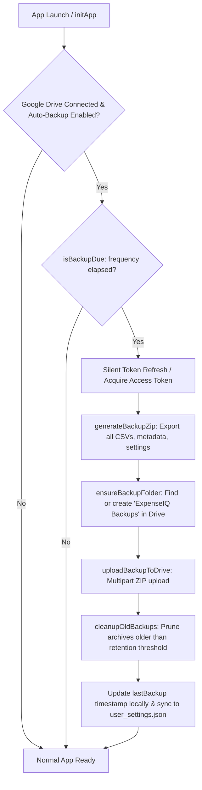
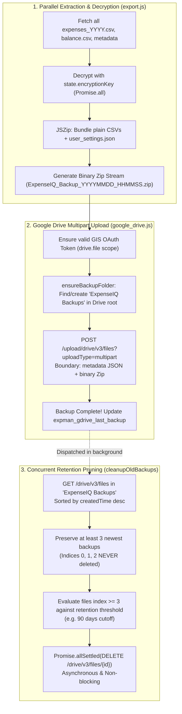

# Google Drive Periodic Backup & Retention Management

## Overview
The Google Drive Periodic Backup feature provides automated, client-side backup of ExpenseIQ data into a dedicated `ExpenseIQ Backups` folder in the user's personal Google Drive. It operates without requiring any background servers or cron infrastructure by performing timestamp evaluations on application launch, and offers configurable retention policies to automatically prune outdated backup archives.

---

## 1. Architecture & Core Workflow



### 1.1 Zero-Server, Client-Driven Periodic Trigger
- **Execution Mechanism**: Backups are evaluated on application initialization (`initApp` in [init.js](file:///d:/Projects/expense-manager/webapp/js/core/init.js)) inside a non-blocking background promise.
- **Interval Checking** (`isBackupDue`): Compares the current timestamp against `expman_gdrive_last_backup`.
  - **Daily**: Interval >= 24 hours (`24 * 60 * 60 * 1000` ms)
  - **Weekly**: Interval >= 7 days (`7 * 24 * 60 * 60 * 1000` ms)
  - **Monthly**: Interval >= 30 days (`30 * 24 * 60 * 60 * 1000` ms)
  - **Manual Only**: Auto-backup disabled.
- **Non-Blocking Execution**: The check and upload run asynchronously after the core UI has rendered so initial app load performance and interactivity are unaffected.

---

### 1.2 Google Identity Services (GIS) & Scopes
- **Library**: Google Identity Services (GIS) Web SDK (`https://accounts.google.com/gsi/client`) loaded dynamically on-demand.
- **Scopes**:
  - `https://www.googleapis.com/auth/drive.file`: Grants access only to files and folders created or opened by ExpenseIQ. Does not access the user's personal Google Drive files.
  - `https://www.googleapis.com/auth/userinfo.email`: Resolves the authorized Google user's email address.
  - `openid`: Standard OpenID Connect token resolution.
- **Token Management & Persistence**:
  - Tokens acquired via GIS `google.accounts.oauth2.initTokenClient`.
  - Stored in `localStorage` under `expman_gdrive_token` and `expman_gdrive_expires_at`.
  - Linked connection state persisted in `expman_gdrive_connected` and synced to cloud `user_settings.json` so the connected state survives browser refreshes and multi-device sessions.
  - **Silent Refresh**: Expired tokens are refreshed via silent GIS prompt (`prompt: ''`) without interrupting the user.

---

### 1.3 Backup Destination & Upload Engine
- **Dedicated Folder**: Creates or reuses a root folder named `ExpenseIQ Backups` via the Google Drive REST API v3 (`mimeType = 'application/vnd.google-apps.folder'`).
- **Archive Format**: Standard `.zip` archive containing all user transaction CSVs, metadata, and settings (generated via `generateBackupZip()` in [export.js](file:///d:/Projects/expense-manager/webapp/js/services/export.js)).
- **Naming Pattern**: `ExpenseIQ_Backup_YYYYMMDD_HHMMSS.zip`.
- **Upload Protocol**: Google Drive v3 Multipart upload (`/upload/drive/v3/files?uploadType=multipart`) sending metadata JSON + binary ZIP stream in a single request.

---

### 1.4 Configurable Retention & High-Performance Cleanup



- **Non-Blocking Background Pruning**: Immediately following a successful upload in [google_drive.js](file:///d:/Projects/expense-manager/webapp/js/services/google_drive.js), retention cleanup is dispatched asynchronously in the background. The backup operation resolves and notifies the user immediately without waiting for Drive deletion calls.
- **Concurrent Deletions**: `cleanupOldBackups()` deletes outdated files concurrently via `Promise.allSettled()` rather than sequential round trips.
- **Parallel Backup ZIP Packaging**: [export.js](file:///d:/Projects/expense-manager/webapp/js/services/export.js) fetches and decrypts user files concurrently via `Promise.all()` to minimize packaging latency.
- **Configurable Retention Policies** (`expman_gdrive_retention`):
  - `keep_all`: Keep all backup files indefinitely (No auto-delete).
  - `7_days`: Delete backups older than 7 days.
  - `30_days`: Delete backups older than 30 days.
  - `60_days`: Delete backups older than 60 days.
  - `90_days`: Delete backups older than 90 days (Default).
  - `180_days`: Delete backups older than 6 months.
  - `365_days`: Delete backups older than 1 year.
- **Safety Guarantee**: The `cleanupOldBackups()` algorithm sorts backups by `createdTime desc` and always preserves at least the **3 most recent backup files** (indices 0, 1, and 2), even if all of them are older than the retention threshold. Only older archives starting from the 4th newest onward are evaluated for deletion against the cutoff time.

---

## 2. Settings UI & Error Handling

### 2.1 Compact Settings Card Layout
Located in the **Settings** view under Data Backup:
- **OAuth Client ID Configuration**: Collapsible `<details>` guide with dynamic origin detection (`window.location.origin`), direct project-specific Google Drive API enablement link, and a **Save** button that syncs `gdriveClientId` to Firebase.
- **Connection Status**: Badge showing `Google Account Connected (user@gmail.com)` or `Not connected`.
- **Connect / Disconnect Buttons**: Initiates OAuth consent popup or revokes local token session.
- **Backup Now Button**: Prominent action button; disabled and dimmed when disconnected with a tooltip prompting connection.
- **Collapsible Auto-Backup & Retention Panel** (`<details id="gdrive-settings-panel">`): Keeps the card compact and uncluttered. Expands to show:
  - **Auto Backup on App Launch (Toggle)**: Turns launch-time backup on/off; dynamically dims and disables the frequency dropdown when unchecked.
  - **Backup Frequency (Dropdown)**: Configures Daily, Weekly, or Monthly intervals.
  - **Auto-Delete Older Backups (Dropdown)**: Configures backup retention duration.
- **Last Backup Status & Failure Banner**: Displays formatted timestamp of the most recent successful backup, and an inline error banner (`#gdrive-error-banner`) with timestamp and description if the latest backup attempt failed.

---

## 2.2 Robust Error Handling & GIS Safety
- **OAuth Popup Cancellation & Timeout**: Configured `error_callback` on `initTokenClient` and a 60-second safety timeout in `connectGoogleDrive()` so closing or dismissing the consent popup immediately settles the promise and restores the "Backup Now" / "Connect" buttons.
- **Always Reset Button in `finally`**: The "Backup Now" button event listener resets button text, state, and calls `updateGoogleDriveUI()` in a `finally` block to prevent hanging states.
- **Inline Failure Status**: If a backup fails, the error message and timestamp are stored in `expman_gdrive_last_error` and `expman_gdrive_last_error_time`, rendered in the Backup UI error banner, and automatically cleared upon the next successful backup.
- **403 Forbidden Modal**: If Google Drive API is not enabled in the user's Google Cloud project (`403 accessNotConfigured`), ExpenseIQ extracts the project activation link and displays `showEnableDriveApiModal` with a one-click button to open Google Cloud Console and retry.

---

## 3. Storage Keys & Cloud Sync

| Storage Key | Type | Description |
| :--- | :--- | :--- |
| `expman_gdrive_connected` | `boolean` | Connection flag synced across devices via `user_settings.json.googleDrive.connected` |
| `expman_gdrive_token` | `string` | Short-lived OAuth access token (stored locally per device) |
| `expman_gdrive_expires_at` | `number` | Timestamp ms when access token expires |
| `expman_gdrive_email` | `string` | Connected Google account email (synced to `user_settings.json.googleDrive.email`) |
| `expman_gdrive_last_backup` | `number` | Timestamp ms of most recent successful backup (synced to `user_settings.json.googleDrive.lastBackup`) |
| `expman_gdrive_last_error` | `string` | Error description of the latest failed backup attempt |
| `expman_gdrive_last_error_time` | `number` | Timestamp ms of the latest failed backup attempt |
| `expman_gdrive_auto_backup` | `boolean` | Auto-backup toggle preference (synced to `user_settings.json.googleDrive.autoBackup`) |
| `expman_gdrive_frequency` | `string` | `'daily'` \| `'weekly'` \| `'monthly'` (synced to `user_settings.json.googleDrive.frequency`) |
| `expman_gdrive_retention` | `string` | `'keep_all'` \| `'7_days'` \| `'30_days'` \| `'60_days'` \| `'90_days'` \| `'180_days'` \| `'365_days'` (synced to `user_settings.json.googleDrive.retention`) |
| `expman_gdrive_custom_client_id` | `string` | Custom Google OAuth 2.0 Web Client ID (synced to `user_settings.json.googleDrive.clientId`) |

---

## 4. Android App (WebView) OAuth & Cache Invalidation

### 4.1 Multi-Window Popup & GIS Support
- **Multi-Window Support**: `setSupportMultipleWindows(true)` and `setJavaScriptCanOpenWindowsAutomatically(true)` enabled on the WebView.
- **`onCreateWindow` Popup Dialog**: Implemented in [MainActivity.java](file:///d:/Projects/expense-manager/expenseiq-android-app/app/src/main/java/com/rakeshmalik/expenseiq/MainActivity.java) to render Google OAuth consent popups in a fullscreen dialog window and maintain the `window.opener` bridge for token delivery.
- **User-Agent Sanitization**: Strips `Version/4.0` and `; wv` from the WebView User-Agent to prevent Google's `403 disallowed_useragent` restriction.
- **Google Domains In-App**: [CachedWebViewClient.java](file:///d:/Projects/expense-manager/expenseiq-android-app/app/src/main/java/com/rakeshmalik/expenseiq/webview/CachedWebViewClient.java) allows `accounts.google.com`, `googleapis.com`, and `gstatic.com` directly in the WebView rather than dispatching external browser intents.

### 4.2 Automated Web Cache Invalidation ([SiteCache.java](file:///d:/Projects/expense-manager/expenseiq-android-app/app/src/main/java/com/rakeshmalik/expenseiq/webview/SiteCache.java))
- **Conditional ETag Revalidation**: On app launch / pull-to-refresh, `SiteCache` sends `If-None-Match` for `index.html`.
- **Fast 304 Not Modified**: If no changes were deployed, server returns `304` and app loads instantly from cache (~40ms).
- **Deployment Detection**: If `index.html` content changes on the server (e.g. new `app.js?v=...`), `SiteCache` automatically flushes stale `.js` and `.css` sub-modules from `site_cache/` so the new build is downloaded and cached cleanly.
- **Offline Resiliency**: In the absence of internet connectivity, network checks immediately fail over to cached local files for full offline functionality.

---

## 5. Testing & Maintenance Guidelines

When updating Google Drive backup or export services:
1. Ensure all encryption keys are respected; encrypted CSV files must be decrypted if encryption is unlocked.
2. Verify token expiration handling so expired tokens do not cause unhandled promise rejections.
3. Verify that auto-backup operations run asynchronously and never block main thread UI interactions or app initialization.
4. Verify retention cleanup preserves the latest backup file in all edge cases.
5. Run webapp unit tests:
   ```powershell
   npm test --prefix webapp
   ```
6. Run Android debug build:
   ```powershell
   cd expenseiq-android-app; ./gradlew assembleDebug
   ```
7. Apply cache bursting bump to `index.html` after making frontend changes.
