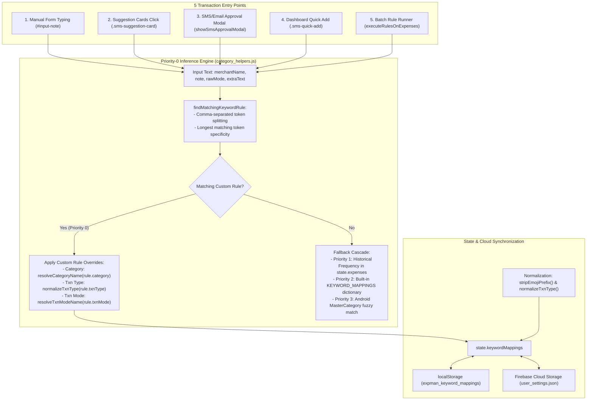

# Custom Keyword Mappings & Inference Override Engine

## Overview
The **Custom Keyword Mappings** feature empowers users to define explicit, priority-0 rules that override the default categorization, transaction type, and payment mode inference across SpendBuddy. When a transaction's merchant, note, or raw payment text matches a user-defined keyword, SpendBuddy enforces the user's custom settings ahead of historical transaction frequency heuristics and hardcoded keyword dictionaries.



---

## 1. Architectural Model & Persistence

### 1.1 In-Memory State & Cloud Schema
- **State Property**: [`state.keywordMappings`](../../webapp/js/core/state.js) is initialized as an Array from `localStorage.getItem('expman_keyword_mappings')`.
- **Cloud Settings**: Persisted in Firebase Cloud Storage under `user_settings.json` within the user's directory (`<userEmail>/user_settings.json`).
- **Normalized Schema (No Emojis)**:
  ```json
  "keywordMappings": [
    {
      "id": "kw_1788850640468",
      "keyword": "NAB",
      "category": "Salary",
      "txnType": "Income",
      "txnMode": "Bank Transfer"
    }
  ]
  ```

### 1.2 Normalization Principle
- **No Emojis in Settings**: `category` and `txnMode` must be stored clean without emoji prefixes (e.g. `"Salary"` instead of `"💰 Salary"`, `"Bank Transfer"` instead of `"🏦 Bank Transfer"`).
- **`stripEmojiPrefix(str)`** in [`category_helpers.js`](../../webapp/js/utils/category_helpers.js): Strips leading pictographic and emoji characters, variation selectors (`\uFE0F`), and joiners (`\u200D`).
- **`normalizeTxnType(str)`**: Enforces standard title casing (`'Income'`, `'Expense'`, `'Investment'`, `'Transfer'`, `'Refund'`).
- **`normalizeKeywordMappings(rules)`** in [`user_settings.js`](../../webapp/js/services/user_settings.js): Enforces normalization on `applyUserSettings` and `updateUserSettings`.

---

## 2. Priority-0 Inference Engine ([`category_helpers.js`](../../webapp/js/utils/category_helpers.js))

### 2.1 Comma-Separated Keyword Matching & Token Specificity
- `findMatchingKeywordRule(text, customRulesList)`:
  - **Comma-Separated Aliases**: Rule keywords can be comma-separated strings (e.g. `"NPS, Protean"`, `"HDFCLife, HDFC Life, LIC"`).
  - **Token Splitting & Normalization**: The engine splits `rule.keyword` on commas, trims whitespace, and converts each alias token to lowercase.
  - **Longest Matching Token Specificity**: If multiple rules match substrings in the target text, the rule with the longest matching individual token takes precedence (e.g., `"HDFC Life"` with length 9 takes priority over `"Life"` with length 4).
  - **Fallback Context**: If the primary merchant name is empty or lacks a rule, the engine checks `extraText` (e.g., `txn.source` or `txn.body`).

### 2.2 Category Inference: `getCategoryForMerchant(merchantName, masterCategory, extraText)`
1. **Priority 0 (Custom Keyword Mapping)**:
   - Matches `merchantName`, `masterCategory`, or `extraText` against custom keyword rules.
   - Resolves clean category using `resolveCategoryName(customRule.category, state.categories)` to return the active state category (with emoji if present).
2. **Priority 1 (Historical Transactions)**:
   - Learns from the user's highest frequency category for that merchant in `state.expenses`.
3. **Priority 2 (Default Keyword Dictionary)**:
   - Matches against built-in `KEYWORD_MAPPINGS`.
4. **Priority 3 (Android MasterCategory)**:
   - Fuzzy matches SMS-parsed masterCategory against `state.categories`.

### 2.3 Transaction Type Inference: `getTxnTypeForMerchant(merchantName, defaultTxnType, extraText)`
1. **Priority 0 (Custom Keyword Mapping)**:
   - Matches `merchantName` or `extraText` against custom keyword rules.
   - Returns `normalizeTxnType(customRule.txnType)`.
2. **Priority 1 (Historical Transactions)**:
   - Learns highest frequency type for merchant in `state.expenses`.
3. **Priority 2 (Built-in TXN_TYPE_MAPPINGS)**:
   - Built-in heuristics (e.g., salary, dividend, refund keywords).

### 2.4 Transaction Mode Inference: `getTxnModeForMerchant(merchantName, rawMode, txnModes, extraText)`
1. **Priority 0 (Custom Keyword Mapping)**:
   - Checks `findMatchingKeywordRule(merchantName)`, `findMatchingKeywordRule(rawMode)`, or `findMatchingKeywordRule(extraText)`.
   - Resolves clean mode using `resolveTxnModeName(customRule.txnMode, txnModes)`.
2. **Priority 1 (Fallback Mode Mapping)**:
   - Delegates to `mapTxnMode(rawMode, txnModes)`.

---

## 3. Transaction Entry Sources & Autofill Process

### 3.1 Overview of All Transaction Sources
The keyword mapping and inference engine is invoked across all 5 avenues through which transactions enter or are modified in SpendBuddy:

| Source | File & Handler | Target Fields Inferred | Fallback Inputs Checked |
| :--- | :--- | :--- | :--- |
| **1. Manual Form Typing** | [`form.js`](../../webapp/js/ui/form.js) (`#input-note` event) | Category, Txn Type, Txn Mode | `note` text |
| **2. Suggestion Cards** | [`form.js`](../../webapp/js/ui/form.js) (`.sms-suggestion-card` click) | Note, Category, Txn Type, Txn Mode | `txn.merchant`, `txn.masterCategory`, `txn.transactionMode`, `txn.source` |
| **3. SMS/Email Approval Modal** | [`sms_approval.js`](../../webapp/js/ui/sms_approval.js) (`showSmsApprovalModal` / `#btn-approve-sms`) | Category `<select>`, Txn Type, Txn Mode | `txn.merchant`, `txn.masterCategory`, `txn.transactionMode`, `txn.source` |
| **4. Dashboard Quick Add** | [`dashboard.js`](../../webapp/js/ui/dashboard.js) (`.sms-quick-add` click) | Category, Txn Type, Txn Mode | `txn.merchant`, `txn.masterCategory`, `txn.transactionMode`, `txn.source` |
| **5. Batch Rule Runner** | [`keyword_mappings.js`](../../webapp/js/ui/keyword_mappings.js) (`executeRulesOnExpenses`) | Category, Txn Type, Txn Mode, Amount Sign | `e.note`, `e.merchant`, `e.source` |

---

## 4. UI Architecture & Multi-Device Layout

### 4.1 Sub-View Navigation & Modals
- **Settings Card**: Under `#view-settings`, a card navigates to `#view-keyword-mappings`.
- **Search Bar**: `#search-keyword-mappings` provides real-time client-side filtering.
- **Modal Overlay (`#keyword-mapping-modal-overlay`)**:
  - `#kw-input-keyword`: Text input for merchant or trigger string.
  - `#kw-input-category`, `#kw-input-txntype`, `#kw-input-txnmode`: Dynamic `<select>` dropdowns.
  - Validates non-empty keyword, requires at least 1 override, and prevents duplicate keywords.

### 4.2 Desktop Table View (`@media (min-width: 861px)`)
- Enforces fixed table column layout on `#keyword-mapping-table`:
  - `KEYWORD` (22%), `CATEGORY` (24%), `TXN TYPE` (18%), `TXN MODE` (22%), `ACTIONS` (14%).
- `Txn Mode` explicitly uses `display: table-cell !important;` scoped strictly within `@media (min-width: 861px)` in [`settings.css`](../../webapp/css/views/settings.css) to avoid desktop hiding rules from generic transaction tables.

### 4.3 Mobile & iPad Card View (`@media (max-width: 860px)`)
- Rows render as clean, distinct cards:
  - All cells use `display: flex !important; justify-content: space-between !important; align-items: center !important;`.
  - `td::before` (Label) sits on the far left (`text-align: left !important; white-space: nowrap !important; margin-right: 12px;`).
  - Values, badges, and action buttons sit on the far right (`margin-left: auto !important; text-align: right !important;`).
  - Action buttons (`⚡`, `✏️`, `🗑️`) render in a horizontal row (`.row-actions { flex-direction: row !important; }`).

---

## 5. Batch Execution on Historical Transactions

### 5.1 Invocation Points
- **Single Rule**: `⚡` button in the row actions calls `runKeywordMappingOnExisting(index)`.
- **All Rules**: Header button `⚡ Run on Existing Txns` calls `runAllKeywordMappingsOnExisting()`.

### 5.2 Execution Logic (`executeRulesOnExpenses`)
1. Prompts a confirmation modal displaying which overrides will be applied.
2. Traverses `state.expenses`:
   - Checks `note`, `merchant`, and `source` against sorted rules.
   - Resolves target category and txnMode against current state.
   - Adjusts amount signs: `Income` and `Refund` are negated (`-Math.abs(amount)`), whereas other types are made positive (`Math.abs(amount)`).
3. Gathers all affected years (`e.date.slice(0, 4)`).
4. Persists changes to cloud storage via `saveYearCSV(yr)`.
5. Calls `renderAll()` and displays summary toast.

---

## 6. Entity CRUD Synchronization ([`settings.js`](../../webapp/js/ui/settings.js))

Whenever a Category or Transaction Mode is renamed or deleted in Settings, `syncKeywordMappingsOnEntityChange(entityType, action, oldName, newNameOrFallback)` synchronizes `state.keywordMappings`:

1. **Rename**: Updates matching rules with the new name stripped of emojis.
2. **Delete with Fallback**: Replaces matching values with the user-selected fallback (stripped of emojis).
3. **Delete without Fallback**:
   - For multi-override rules, sets the deleted field to `null` while preserving other overrides.
   - For single-override rules, prunes the rule completely from `state.keywordMappings`.
4. **Delete Dialog Usage Detection**: `deleteCategory` and `deleteTxnMode` count usage in both `state.expenses` and `state.keywordMappings`. If used in keyword rules, the replacement `<select>` prompt is displayed.
5. **Persistence & UI Refresh**: Saves to `localStorage`, syncs to cloud `user_settings.json` via `updateUserSettings`, and re-renders the keyword mappings table.

---

## 7. Verification & Testing Guidelines

When modifying keyword mappings or inference logic, verify the following:
1. **Automated Unit Tests**:
   - Run `npm test` and ensure all suites in [`keyword_mappings.test.js`](../../webapp/tests/keyword_mappings.test.js) pass.
   - Test keyword specificity, overrides precedence, emoji stripping, entity CRUD synchronization, and batch execution.
2. **Android App Verification**:
   - Run `npm run test:android` to verify Android build compatibility.
3. **Multi-Device Responsiveness**:
   - Verify 5-column desktop table layout.
   - Verify mobile card layout: label on left, value/badge on right without text wrapping.
4. **Cache Bursting**:
   - Bump `app.js?v=XXX` in [`index.html`](../../webapp/index.html).
