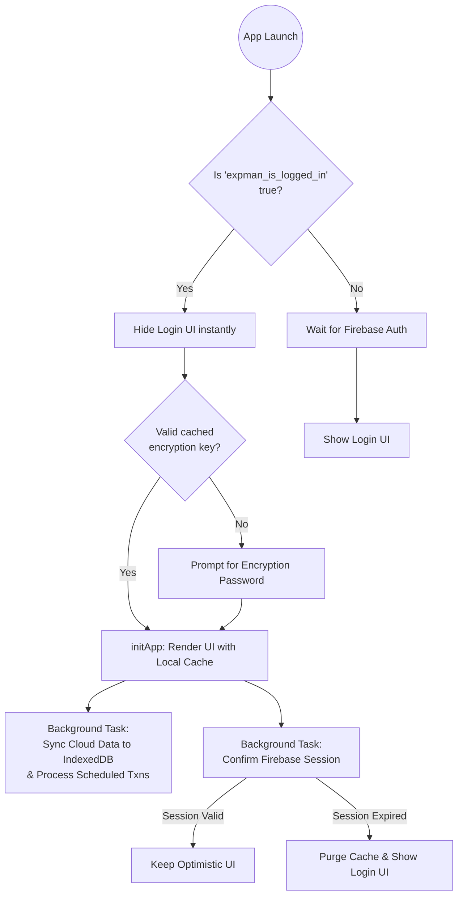
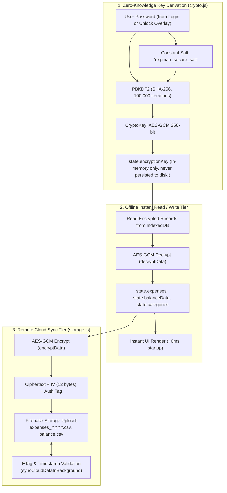
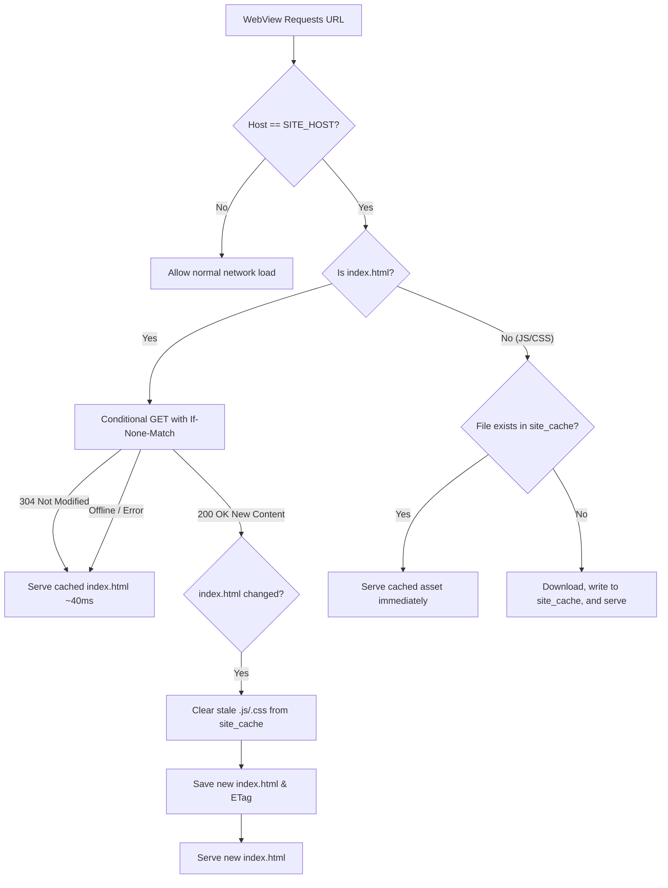

# Initial Login & Caching Architecture

This document explains the initialization, authentication, data caching, and Android WebView asset caching architecture of the application. The system is designed for **zero-wait, instant startup** for returning users by aggressively trusting local caches and performing all network operations asynchronously in the background.

---

## 1. App Boot & Optimistic Loading (`startAuthFlow`)

When the application loads, `startAuthFlow()` in [init.js](file:///d:/Projects/expense-manager/webapp/js/core/init.js) is triggered.
- If `USE_LOCAL_DATA` is enabled in `webapp/config.js`, Firebase is skipped completely and the app boots directly.
- Otherwise, it initializes Firebase Auth and Storage.
- **Optimistic UI:** Before waiting for Firebase Auth to initialize (which requires a network round-trip), the app checks `localStorage` for the `expman_is_logged_in` flag. 
- If `true`, it immediately hides the login screen and proceeds to the decryption flow, providing an instant visual transition.

---

## 2. Signup & End-to-End Encryption Setup

New users can opt into **End-to-End (E2E) Encryption** directly on the signup screen via the `#signup-toggle-encryption` option:
- **Zero-Knowledge Key Derivation**: When checked, `deriveKey(pwd)` in [crypto.js](file:///d:/Projects/expense-manager/webapp/js/utils/crypto.js) derives an AES-GCM 256-bit encryption key from the user's password using PBKDF2 (SHA-256, 100,000 iterations).
- **Cloud Settings Initialization**: `updateUserSettings({ encryptionEnabled: true })` in [user_settings.js](file:///d:/Projects/expense-manager/webapp/js/services/user_settings.js) writes `{ encryptionEnabled: true }` to `{email}/user_settings.json` in Firebase Storage while the new user is authenticated.
- **Race-Condition Protection (`isSigningUp`)**: A module flag `isSigningUp` in [init.js](file:///d:/Projects/expense-manager/webapp/js/core/init.js) prevents `onAuthStateChanged` from prematurely calling `logoutUser()` on the unverified user before `user_settings.json` is committed to cloud storage.
- **Local Resilience & Pending Sync**: `expman_encryption_enabled` is set in `localStorage`. If cloud write is interrupted, `expman_encryption_pending_${email}` acts as a fallback that automatically syncs on the user's first post-verification login.
- **Opt-out Default**: If unchecked, `{ encryptionEnabled: false }` is persisted, and the user can optionally toggle encryption later in Account Settings.

---

## 3. Decryption Flow & Cryptographic Pipeline

The optimistic load or login flow triggers `checkEncryptionAndUnlock()` from [encryption_manager.js](file:///d:/Projects/expense-manager/webapp/js/services/encryption_manager.js):
- **Immediate Login**: When logging in with email and password, the login handler derives `state.encryptionKey = await deriveKey(pwd)` immediately. Thus, when `checkEncryptionAndUnlock()` checks `!state.encryptionKey`, it passes without prompting and unlocks instantly.
- **Cached / Optimistic Boot**: If returning via cached session without typing password, it checks if a valid encryption key is present. If not, the user is prompted with `#unlock-overlay` to enter their password to derive the key.
- Upon successful unlock, the core `initApp()` routine is fired.

---

## 4. Instant Local Cache Render (`initApp`)

The `initApp()` function is responsible for assembling the UI using cached data:
- `loadAllCSVs()`, `loadMetadata()`, and `loadScheduledCSV()` are called. These functions query the local **IndexedDB** cache to fetch all financial records instantly.
- The UI is rendered entirely using this offline local data.
- `initSmsFromCache()` is called to instantly populate the Add Entry page and Dashboard with pending SMS/Email transactions from the local storage cache, prior to Android pushing new ones.

---

## 5. Background Sync (`syncCloudDataInBackground`)

Once the UI is fully rendered and interactive, network requests begin strictly in the background:
- `syncCloudDataInBackground()` connects to Firebase Storage.
- It compares the eTags or timestamps of remote files against the local cache.
- If newer data exists on the cloud (e.g., modified from another device), it downloads, decrypts, and updates the local IndexedDB cache, silently re-rendering the UI.
- **Scheduler Execution:** During this sync, it also invokes `processScheduledTransactions()` to evaluate and auto-post any due recurring transactions before saving to the cloud.
- `startBackgroundRefresh()` initializes a 5-minute polling interval to continually sync the local cache with the cloud while the app remains open.

---

## 6. Manual Sync (Pull-to-Refresh)

On mobile devices, users can manually trigger a cache invalidation check via a native-feeling "Pull-to-Refresh" gesture on the dashboard:
- This bypasses the 5-minute polling interval and immediately invokes `syncCloudDataInBackground()`.
- The UI handles the touch gesture physics natively via `helpers.js` and provides visual feedback via a spinner that dynamically tracks the scroll gap.
- Once the background sync completes (resolving new eTags/timestamps), the UI updates seamlessly.

---

## 7. Android WebView Web Asset Caching (`SiteCache.java` & `CachedWebViewClient.java`)

To ensure zero latency and offline capability inside the Android APK while allowing web updates to deploy seamlessly without freezing stale assets:

### 7.1 Key Asset Caching Principles:
1. **Entry Point Revalidation (`index.html`)**:
   - `index.html` is the root shell containing script tags like `<script type="module" src="app.js?v=XXX">`.
   - On launch / refresh, [SiteCache.java](file:///d:/Projects/expense-manager/expenseiq-android-app/app/src/main/java/com/rakeshmalik/expenseiq/webview/SiteCache.java) sends a conditional `If-None-Match` request.
   - If no update was deployed, the server responds with `304 Not Modified` in ~40ms, loading instantly from disk.
   - If a new build was deployed (`200 OK`), `SiteCache` detects the content change and flushes stale `.js`/`.css` modules from `site_cache/`, ensuring the fresh build and sub-modules are loaded.
2. **Offline Fallback**:
   - If the device is offline, `SiteCache` catches network exceptions and immediately serves the cached `index.html` and assets from disk.
3. **`WIPE_CACHE_ON_STARTUP` Flag**:
   - Located in [AppConfig.java](file:///d:/Projects/expense-manager/expenseiq-android-app/app/src/main/java/com/rakeshmalik/expenseiq/AppConfig.java).
   - **Must remain `false` in production**.
   - It is strictly a developer troubleshooting tool to force a one-time wipe of `site_cache`, `sms_cache_json`, and `expman_sms_*` approval keys. Keeping it `true` permanently will cause approved/discarded transactions to reset on every launch.

---

## 8. Late Auth Confirmation

Eventually, the Firebase `onAuthStateChanged` callback fires:
- **Success:** If the optimistic load was correct (the user has a valid Firebase session), it simply updates the UI with the user's email (e.g., in the sidebar).
- **Failure:** If the session is invalid or expired (meaning the `onAuthStateChanged` returns a `null` user), the app detects that the optimistic load was a false positive. It immediately purges all `expman_*` keys from `localStorage` and reloads the page to safely present the login screen.
