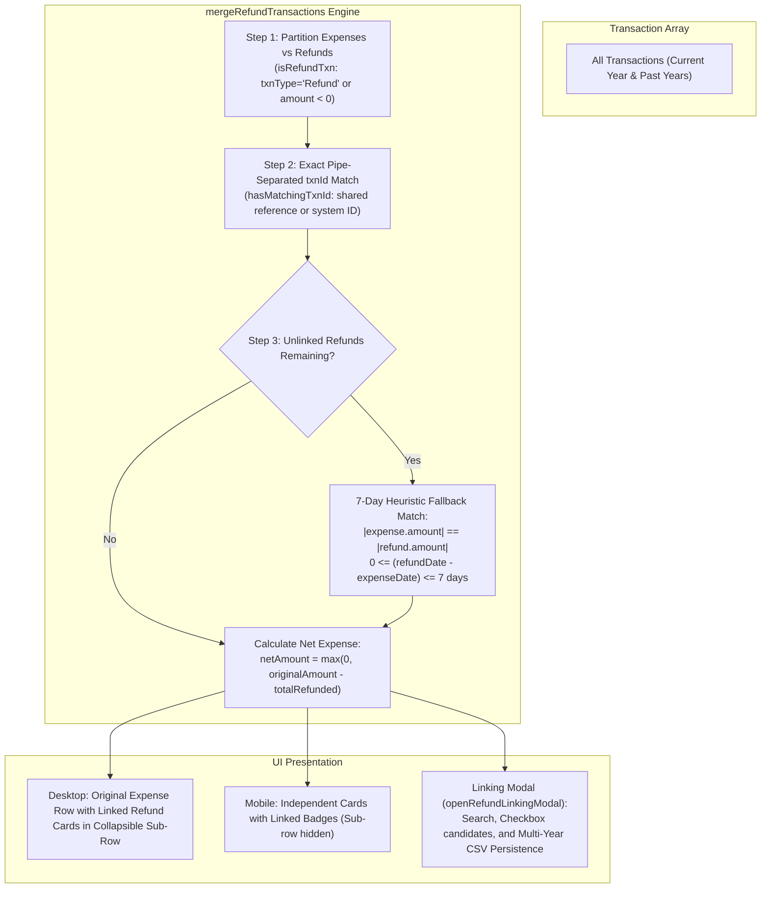
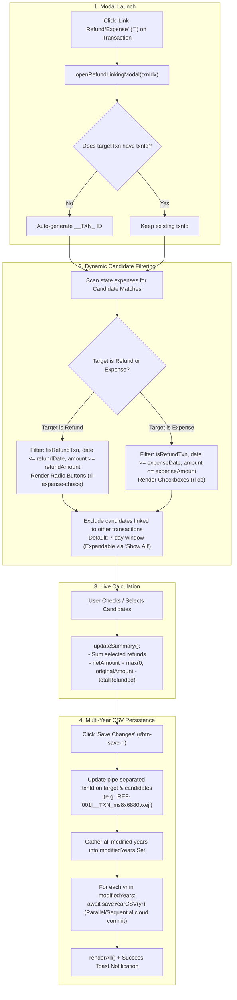

# Refund Linking & Sub-Row UI Architecture

## Overview
The Refund Linking feature connects **Original Expenses** with **Refund Transactions**. It automatically groups matching refunds with expenses to present net expense totals, provides a collapsible desktop sub-row UI, and exposes an interactive modal for manual linking and unlinking across multi-year data.



---

## 1. Architectural Concept & ID Model

### 1.1 Pipe-Separated Transaction IDs
- Linking is established by matching IDs in the `txnId` / `TransactionId` field.
- Multiple IDs (e.g., bank reference numbers + auto-generated system IDs) are concatenated with pipes:
  ```
  605761060095|__TXN_ms8x6880vxej
  ```
- Functions in [`txn_id_helpers.js`](../../webapp/js/utils/txn_id_helpers.js):
  - `getTxnIdList(t)`: Returns array of trimmed IDs from `t.txnId` or `t.transactionId`.
  - `hasMatchingTxnId(t1, t2)`: Returns `true` if any ID in `t1` matches any ID in `t2`.
  - `isSystemTxnId(id)`: Returns `true` if ID starts with `__TXN_`, `__SCHEDULER_`, or `__QUICKADD_`.

### 1.2 Refund Classification
- `isRefundTxn(t)` checks if `txnType === 'Refund'` OR `amount < 0` (for expenses).
- Amounts for refunds are displayed with `+₹` prefix in green (`.amount-negative`).

---

## 2. Auto-Grouping & Net Calculation (`refund_helpers.js`)

`mergeRefundTransactions(transactions, allTransactions)` processes transaction arrays into grouped objects:

```javascript
{
    main: expenseTxn,
    refunds: [refundTxn1, refundTxn2],
    totalRefunded: 500.00,
    netAmount: 1500.00,
    merged: refundTxn1
}
```

### Grouping Algorithm Steps:
1. **Step 1 (Expenses)**: Collects all non-refund expenses into primary groups.
2. **Step 2 (ID Matching)**: Scans all refund transactions sharing a `txnId` with `group.main`. Sums `totalRefunded` and calculates:
   $$\text{netAmount} = \max(0, \text{originalAmount} - \text{totalRefunded})$$
3. **Step 3 (Heuristic Fallback)**: Unlinked refunds are auto-matched to expenses with exact opposite amounts ($|\text{expense}| = |\text{refund}|$) within a 7-day window ($0 \le \text{diffDays} \le 7$).

### 2.1 Settings Flag: `mergeRefunds` (`#toggle-merge-refunds`)
- **Settings Toggle**: Controlled via `Settings -> Visibility Preferences -> Refund Merging -> Merge Refunds with Expenses` (`#toggle-merge-refunds`).
- **State & Storage**: Backed by `state.mergeRefunds`, `localStorage.getItem('expman_merge_refunds') !== 'false'` (defaults to `true`), and synced with cloud `user_settings.json` under `ui.mergeRefunds`.
- **Behavior when Disabled (`state.mergeRefunds === false`)**:
  - `mergeRefundTransactions` returns each transaction as an independent standalone entry without grouping (`refunds: []`, `netAmount = |amount|`).
  - All refunds appear on their own original transaction dates as standalone rows/cards (with `+₹` green formatting) across the Dashboard and Transactions views.

---

## 3. Collapsible Sub-Row UI (`refund_helpers.js` & `tables.css`)

### 3.1 Desktop Sub-Row (`renderRefundCollapsibleSubrow`)
- **Desktop Only**: Sub-rows use `.refund-collapsible-row.hide-on-mobile`. They are hidden on mobile (`<= 860px`) to prevent card grid breaking.
- **Badge Toggle**: On desktop, an "Original Expense" or "Refund" badge (`.badge-refund-toggle`) displays a toggle arrow (`▼`) that invokes `toggleRefundCollapsible('dash-row-N', event)`.
- **Sub-Row Content**:
  - Displays linked refund cards with Date, Category, Note, Badges (Source ID), Mode, and Amount (`+₹X.XX`).
  - Action buttons in sub-row cards allow inline Linking (`🔗`), Editing (`✏️`), and Deleting (`🗑️`).

### 3.2 Mobile Actions & Linking Access
- **Mobile Grid Card Integrity**: On mobile screens (`<= 860px`), full-width nested sub-rows are suppressed (`hide-on-mobile`) to prevent horizontal card stretching.
- **Mobile Action Sheet**: Tapping the `⋮` action button on an expense or refund card opens the slide-up action sheet, exposing:
  - **"Link Refund"** (or **"Link Expense"**): Directly opens the interactive linking modal.
  - **"Add Refund Entry"**: Automatically generates a linked refund.
  - **"Delete Linked Refund(s)"**: Bulk deletes all linked refunds for that expense.
- **Visual Feedback**: Mobile cards render compact inline pill badges (`[Refund]`, `[Net ₹X.XX]`) directly beside the note text on Line 2.

### 3.3 Direct One-Click Refund Generation (`generateRefund`)
- Clicking the refund action button (`↩️`) on an expense row directly creates, links, and saves a corresponding refund entry (`txnType: 'Refund'`, amount `-Math.abs(expense.amount)`, shared `txnId`).
- It saves the updated CSV for that year and refreshes the UI immediately **without navigating away to the Add Entry form**.

---

## 4. Interactive Linking Modal (`refund_linking_modal.js`)

`openRefundLinkingModal(txnIdx)` opens a modal overlay allowing users to search, select, link, or unlink candidate transactions across current and past years.



- **System Txn ID Auto-Population**: Upon opening the modal, if `targetTxn` has no `txnId` (or if `txnId` is empty), a system transaction ID starting with `__TXN_` is automatically generated and populated for `targetTxn` (regardless of whether it is an Expense or a Refund target).

### 4.1 Candidate Filtering Rules

| Target Type | Candidate Type | Date Rule | Amount Rule | Input Type |
| :--- | :--- | :--- | :--- | :--- |
| **Refund Target** | Expenses (`!isRefundTxn`) | `candidateDate <= refundDate` | `candidateAmount >= refundAmount` | Radio (`rl-expense-choice`) |
| **Expense Target** | Refunds (`isRefundTxn`) | `candidateRefundDate >= expenseDate` | `expenseAmount >= candidateRefundAmount` | Checkbox (`rl-cb`) |

- **Unlinked Constraint**: Candidates already linked to a different transaction are excluded to prevent cross-linking corruption.
- **7-Day Default Window**: Transactions within 7 days are displayed by default, with a `"📂 Show All Eligible Transactions"` button to reveal older candidates.

### 4.2 Live Summary & Saving
- **Live Calculation**: As checkboxes/radios toggle, `updateSummary()` dynamically updates `Total Refunded` and `Net Expense` in real-time.
- **Saving (`#btn-save-rl`)**:
  1. Updates `txnId` fields on target and candidate objects.
  2. Tracks all modified 4-digit years in `modifiedYears = new Set()`.
  3. Iterates over `modifiedYears` and awaits `saveYearCSV(year)` for each year.
  4. Triggers `renderAll()` and displays a success toast (`"Transaction links updated!"`).

---

## 5. Deletion Semantics (Individual vs Linked Refunds)

1. **Individual Refund Deletion**:
   - Each refund is a distinct row object in `state.expenses`.
   - Deleting a refund from its individual row, action dropdown, or mobile sheet (`isTargetRefund = true`) invokes `openDeleteModal(realIdx)` which deletes **ONLY that single individual refund**.
   - The original parent expense and any other linked refunds remain untouched in `state.expenses`.

2. **Bulk Linked Refund Deletion**:
   - When viewing an Original Expense with linked refunds in the mobile action sheet, selecting **"Delete Linked Refund(s)"** invokes `openDeleteMultipleModal(refundIndices)` to delete all linked refunds for that expense at once, after displaying an explicit confirmation modal.

---

## 6. Testing & Maintenance Guidelines

1. **Automated Unit Tests**:
   - Always run `npm test` after modifying refund logic to verify `webapp/tests/refund_linking.test.js`.
2. **Multi-Device Verification**:
   - **Desktop**: Verify clicking badge toggle expands sub-row smoothly and rotates arrow `▼`.
   - **Mobile / Android**: Verify collapsible sub-row is hidden (`hide-on-mobile`) and mobile cards render clean left-aligned / inline badges.
   - **Modal**: Verify searching, checking/unchecking candidates, live summary calculation, and multi-year CSV saving.
3. **Cache Bursting**:
   - Increment CSS/JS version parameters in `webapp/index.html` whenever updating refund modal or table sub-row styles.


---

## 7. Activity History Integration

Refund operations are recorded as transaction events:

- **Generate Refund (`generateRefund`)**: after the year CSV save succeeds, records `added` with `type: "txn"` and source `Refund Action`.
- **Link / unlink existing transactions**: after all modified year CSVs save, records `updated` for each transaction whose `txnId` changed. The `changes` array stores the old and new `txnId`.
- **Delete a refund or linked refund group**: uses the standard single/bulk transaction deletion path, producing one `deleted` event per deleted row with a snapshot.

The relationship is represented by pipe-separated transaction IDs; there is no separate `refund_linked` action. See [Activity History](activity-history.md) for supported diff fields and persistence ordering.
