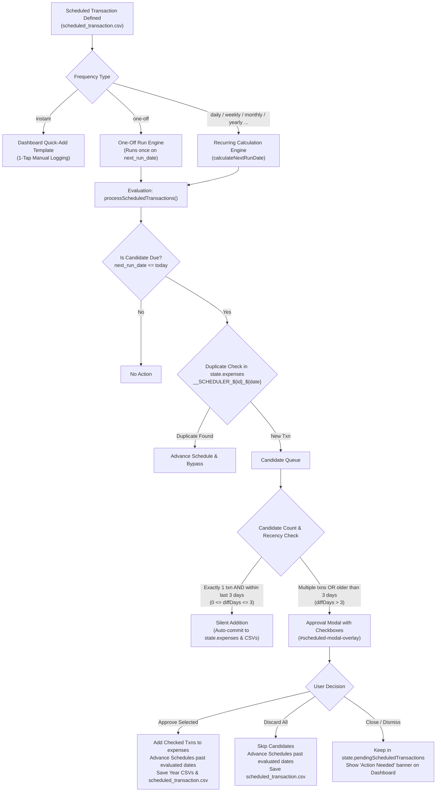
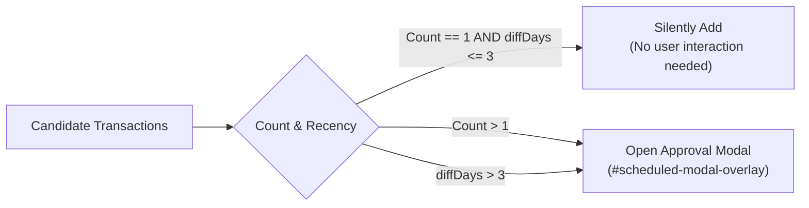

# Scheduled Transactions Architecture & Specification

## Overview
Scheduled transactions in SpendBuddy automate recurring income, expenses, and investment entries, support future one-off dated entries, and power 1-tap "Quick Add" dashboard templates. The subsystem handles recurrence calculations, end-condition lifecycles, duplicate prevention, background execution, and conditional user approval before committing entries to actual expenses.



---

## 1. Frequency Types & Recurrence Engine

Recurrence calculations are encapsulated in [`scheduling_helpers.js`](../../webapp/js/utils/scheduling_helpers.js) using pure date arithmetic without UI coupling:

| Frequency | Description | Recurrence Logic | Example |
| :--- | :--- | :--- | :--- |
| `instant` | Quick Add template | Never runs automatically; displays a 1-tap button on dashboard | Coffee `₹50` |
| `one-off` | Single future schedule | Executes once on `next_run_date`, then automatically removed | Insurance Premium |
| `daily` | Every day | `d.setDate(d.getDate() + 1)` | Daily Milk Delivery |
| `weekly` | Every week | Advances 7 days, or iterates over `recur_weekdays` | Weekly Groceries |
| `biweekly` | Every 2 weeks | Advances 14 days, or alternates week over `recur_weekdays` | Biweekly Cleaning |
| `monthly` | Every month | Advances 1 month to `recur_day`, clamped to month end (e.g. Feb 28/29) | House Rent |
| `bimonthly` | Every 2 months | Advances 2 months to `recur_day` | Electricity Bill |
| `quarterly` | Every 3 months | Advances 3 months to `recur_day` | Advance Tax |
| `yearly` | Every year | Advances 1 year to `recur_month` and `recur_day` | Term Insurance |

### Recurrence Calculation (`calculateNextRunDate`)
- **Multi-weekday Support**: For `weekly` and `biweekly`, `st.recur_weekdays` supports arrays of days (e.g. `[1, 3, 5]` for Mon/Wed/Fri). The calculator advances to the next matching weekday in sequence.
- **Calendar Clamping**: Monthly and yearly recurrences clamp `recur_day` to the maximum valid days in the target month (e.g., day 31 becomes February 28 or 29 in leap years).
- **Initial Setup Adjustment**: When configuring a new schedule, if the selected day/month falls in the past relative to the start date, the calculator automatically shifts `next_run_date` to the subsequent period.

---

## 2. End Conditions & Lifecycle

Every schedule defines its completion lifecycle via `end_condition`:

- **`never`**: Runs indefinitely until explicitly paused or deleted.
- **`until_date`**: Automatically sets `disabled = true` when `next_run_date > end_date`.
- **`after_occurrences`**: Automatically sets `disabled = true` when `run_count >= max_occurrences`.
- **`enabled`**: Composite rule; terminates when either `next_run_date > end_date` OR `run_count >= max_occurrences` is reached.
- **`disabled` (Boolean)**: Pauses execution without deleting the schedule. Disabled schedules are skipped during `processScheduledTransactions()`.

---

## 3. Execution & Conditional Approval Engine

Scheduled transactions are evaluated whenever:
1. The app finishes initial sync (`syncCloudDataInBackground()`).
2. Periodic background refresh triggers (every 5 minutes).
3. A schedule is added or updated in the form (`setupForm()`).

### 3.1 Deduplication & Idempotency
Each scheduled transaction generates a deterministic, synthetic transaction ID:
```text
__SCHEDULER_${scheduleId}_${entryDate}
```
Before adding an entry, the engine checks for duplicates against `state.expenses`:
```javascript
const isDup = state.expenses.some(e =>
    e.txnId === generatedTxnId ||
    (e.date === entryDate &&
        e.amount === st.amount &&
        e.category === st.category &&
        e.note === st.note)
);
```
If an entry with that ID or matching tuple already exists, it is considered already logged and is skipped. The schedule advances its `next_run_date` to prevent re-evaluating past dates.

### 3.2 Conditional Approval Rules

When candidate transactions are ready to be logged:



#### Rule 1: Silent Addition (Single Transaction in Last 3 Days)
- **Condition**: Exactly 1 candidate transaction is due AND its entry date is within the last 3 days relative to today (`0 <= diffDays <= 3`):
  - Today (0 days ago)
  - Yesterday (1 day ago)
  - 2 days ago
  - 3 days ago
- **Action**:
  - Automatically prepends transaction to `state.expenses`.
  - Advances schedule (`next_run_date`, `run_count`, `last_run_date` or removes if one-off).
  - Persists changes to the respective year CSV and `scheduled_transaction.csv`.
  - Displays a brief toast: `Processed 1 scheduled transaction(s)`.

#### Rule 2: Approval Modal (Multiple or > 3 Days Old)
- **Condition**: 2 or more candidate transactions are due, OR a single transaction is older than 3 days (e.g., user opened app after weeks of inactivity).
- **Action**: Opens `#scheduled-modal-overlay` without modifying `state.expenses`.

### 3.3 Modal Interactions & Controls ([`scheduled_approval.js`](../../webapp/js/ui/scheduled_approval.js))
- **Card Display**: Each due transaction displays:
  - Checkbox (`.scheduled-checkbox`), checked by default.
  - Date formatted with calendar icon (plus an `Overdue` badge if `> 3` days old).
  - Amount colored green (+) for income/refund or red for expense.
  - Category dropdown pre-populated with the schedule's category, customizable before approval.
  - Transaction mode and note.
- **Select All**: Toggles all checkboxes and dynamically updates the action button label: `Approve Selected (N)`.
- **Approve Selected**:
  - Adds only the checked transactions to `state.expenses` (applying any category changes made in dropdowns).
  - Advances all evaluated schedules past their candidate occurrences (so unchecked transactions are not re-prompted).
  - Saves modified year CSVs and `scheduled_transaction.csv`.
  - Closes modal and updates UI.
- **Discard All**:
  - Advances all evaluated schedules past the candidate occurrences without adding any actual transactions to expenses.
  - Saves `scheduled_transaction.csv`.
- **Close Button / Backdrop Click**:
  - Closes modal without altering state or advancing schedules.
  - Candidates remain in `state.pendingScheduledTransactions`.
  - A banner `⚡ Scheduled Txns (N) - Action Needed` appears in the dashboard quick-add area, allowing the user to reopen the modal at any time.

---

## 4. Conflict Handling & ETag Rollback

To prevent data loss or premature schedule advancement during network failures or concurrent device sync:
1. `processScheduledTransactions()` snapshots `state.scheduledTransactions` and `state.expenses`.
2. If saving year CSVs or scheduled CSV encounters a `CONFLICT_DETECTED` error from the ETag manager, in-memory mutations are completely rolled back to the snapshot.
3. This guarantees that `next_run_date` is never permanently advanced if the corresponding expense entries fail to save to the cloud.

---

## 5. CSV Schema: `scheduled_transaction.csv`

The file is stored in Firebase Storage under `{userEmail}/scheduled_transaction.csv`:

```csv
ID,Disabled,Amount,Amount Expression,Currency,Category,Transaction Mode,Note,Frequency,Recur Month,Recur Day,Recur Weekday,Start Date,Last Run Date,Next Run Date,End Condition,End Date,Max Occurrences,Run Count,Transaction Type,Location,Tag
```

### Column Specification

| Column | Type | Description | Example |
| :--- | :--- | :--- | :--- |
| `ID` | String | Unique timestamp-based schedule ID | `1726574892012` |
| `Disabled` | Boolean | Paused state (`true` / `false`) | `false` |
| `Amount` | Number | Evaluated numeric transaction amount | `1500` |
| `Amount Expression` | String | Infix arithmetic expression (if used) | `1000+500` |
| `Currency` | String | 3-letter currency code | `INR` |
| `Category` | String | Master expense/income category | `Utilities` |
| `Transaction Mode` | String | Payment method | `UPI` |
| `Note` | String | Description or payee name | `Electricity Bill` |
| `Frequency` | String | `instant`, `one-off`, `daily`, `weekly`, `biweekly`, `monthly`, `bimonthly`, `quarterly`, `yearly` | `monthly` |
| `Recur Month` | Number | 1–12 (yearly frequency only) | `4` |
| `Recur Day` | Number | 1–31 (monthly/yearly frequencies) | `15` |
| `Recur Weekday` | String | Single day (`0`–`6`) or pipe-separated (`1\|3\|5`) | `1\|3\|5` |
| `Start Date` | String | Anchor date `YYYY-MM-DD` | `2026-01-01` |
| `Last Run Date` | String | Date of previous run `YYYY-MM-DD` | `2026-08-15` |
| `Next Run Date` | String | Next due execution date `YYYY-MM-DD` | `2026-09-15` |
| `End Condition` | String | `never`, `until_date`, `after_occurrences`, `enabled` | `never` |
| `End Date` | String | Terminal cutoff date `YYYY-MM-DD` | `2026-12-31` |
| `Max Occurrences` | Number | Maximum allowed run count | `12` |
| `Run Count` | Number | Total times executed to date | `8` |
| `Transaction Type` | String | `Expense`, `Income`, `Investment`, `Transfer`, `Refund` | `Expense` |
| `Location` | String | Tagged location string | `Home` |
| `Tag` | String | Custom categorization tag | `Bills` |

---

## 6. Settings UI & Desktop Inline Editing

In **Settings > Scheduled Transactions** (`#scheduled-table`), schedules are presented in a responsive data table (`> 860px`) and collapsible card grid (`<= 860px`):

### 6.1 Column Layout & Type/Mode Representation
- **Desktop Columns (`> 860px`)**:
  `Category | Type | Mode | Note | Amount | Freq | Next Run | Last Run | Actions`
  - `Type`: Displayed using standard badges (`.badge-txn-type.type-{expense|income|investment|transfer|refund}`).
  - `Mode`: Displayed inside a styled pill (`.mode-cell`).
  - `Actions`: Includes Enable/Disable toggle (`▶️`/`⏸️`), Quick Edit (`⚡`), Full Edit (`✏️`), and Delete (`🗑️`).
- **Mobile Responsive Layout (`<= 860px`)**:
  - In [`responsive.css`](../../webapp/css/layout/responsive.css), table cells for `Type`, `Mode`, and `Last Run` are hidden (`display: none !important`).
  - `Type` and `Mode` badges are rendered inside the `Note` card area (`.badges-wrapper.hide-on-desktop`) to keep the mobile 3-row grid geometry intact.
  - The mobile action sheet modal (`openScheduledMobileMenu`) explicitly includes `st.txnMode` in the summary header.

### 6.2 Desktop-Only Inline Editing
- **Triggers**: Double-clicking any scheduled transaction row (`ondblclick`) or clicking the `⚡` Quick Edit action button.
- **Device Guard**: On mobile viewports (`window.innerWidth <= 860`), inline edit is bypassed and redirects immediately to the full edit form (`editScheduledTransaction(idx)`).
- **Inline Controls**:
  - **Category**: Dropdown `<select>` pre-populated with `state.categories`.
  - **Type**: Dropdown `<select>` pre-populated with `state.txnTypes` (`Expense`, `Refund`, `Income`, `Investment`, `Transfer`).
  - **Mode**: Dropdown `<select>` pre-populated with `state.txnModes`.
  - **Note**: Text `<input>` for inline description edits.
  - **Amount**: Arithmetic text `<input>` with live evaluation preview pill showing calculated amount and sign adaptation (e.g. negative for `Income`/`Refund`).
- **Keyboard Shortcuts**:
  - `Enter`: Validates and saves inline changes (`saveScheduledInlineEdit(idx)`).
  - `Escape`: Cancels inline editing without modifying state (`cancelScheduledInlineEdit()`).
- **Persistence**: Upon saving, updates `state.scheduledTransactions[idx]`, uploads `scheduled_transaction.csv` to cloud storage, re-renders the table, and flashes the saved row with a blue transition animation.

---

## 7. Key Invariants to Maintain

When modifying or extending the scheduled transactions subsystem, preserve these invariants:

1. **Deterministic Txn ID Format**: Always prefix generated transactions with `__SCHEDULER_${st.id}_${entryDate}` for cross-device idempotency.
2. **Dual-Path Execution**:
   - Single txn in last 3 days (`0 <= diffDays <= 3`) → MUST execute silently without modal interruption.
   - Multiple txns or txn older than 3 days → MUST show approval modal with pre-selected checkboxes.
3. **Atomic Advance on Skip/Discard**: When candidate occurrences are discarded or unchecked during approval, schedules MUST advance past those dates so users are not re-prompted on subsequent syncs.
4. **ETag Conflict Rollback**: In-memory state mutations must always be reverted if CSV upload encounters `CONFLICT_DETECTED`.
5. **Expression Continuity**: Carry forward `amountExpression` into both `state.expenses` and `scheduled_transaction.csv`.
6. **Month-End Clamping**: Never set a day beyond the valid days of the month (e.g. day 31 in Feb must clamp to 28/29).
