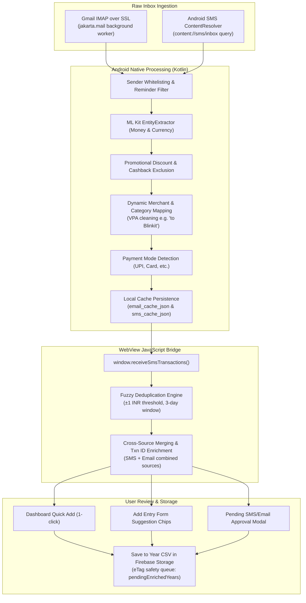
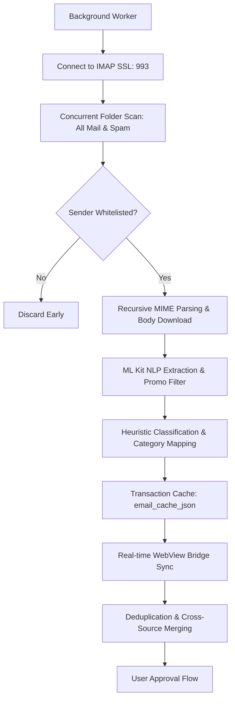
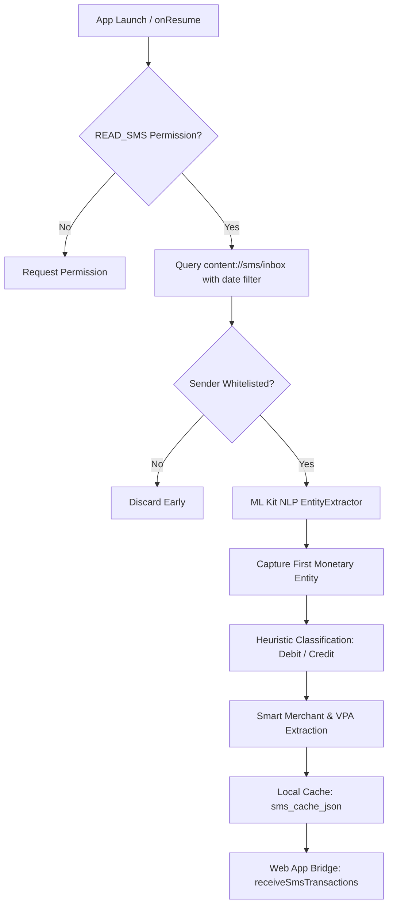
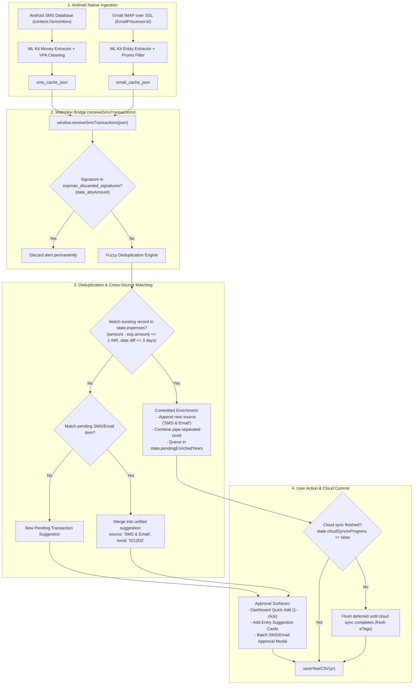

# SMS & Email Transaction Analysis Architecture

## Overview
This document outlines the architectural approach for extracting, filtering, deduplicating, and approving financial transactions from bank SMS messages and Gmail directly within the companion Android application and the web app bridge.

---

## 1. Email Transaction Analysis (Native Android IMAP Client)

The email processing engine uses a background worker (`EmailProcessor.kt`) that connects directly to Gmail via IMAP using `jakarta.mail`. It runs silently in the background when the app opens.

### 1.1 Authentication & Connection
- **Protocol**: Connects to `imap.gmail.com` using SSL over port 993.
- **Authentication**: Authenticated via a **Google App Password** securely stored in Android Keystore / SharedPreferences.
- **Credential Cloud Sync**: IMAP credentials (email + app password) are consolidated in `<userEmail>/user_settings.json` under the `"gmail"` namespace for cross-device restoration.
  - **Save**: When a user links Gmail in Android, `saveGmailCredentialsToCloud()` in `webapp/js/services/gmail.js` updates `user_settings.json.gmail`.
  - **Load**: On app launch, `loadGmailCredentialsFromCloud()` reads `user_settings.json` and restores credentials to Android via `WebAppInterface.saveImapCredentials()`.
  - **Delete**: Unlinking Gmail calls `deleteGmailCredentialsFromCloud()`, removing `"gmail"` from cloud settings.
- **Concurrent Scanning**: Connects and scans `"[Gmail]/All Mail"` and `"[Gmail]/Spam"` concurrently using Kotlin coroutines to slash IMAP network latency.
- **Message Limiting**: Bounded to the last 100 recent messages per folder (or 7 days). On first scan, it dynamically upgrades to 60 days / 500 messages to backfill historical transactions.

### 1.2 Data Fetching & Caching
- **Timestamp Caching**: Stores `last_email_scan_time` in `SharedPreferences`. Halts backward scanning once an email older than this timestamp is reached.
- **Cache Hit Short-circuiting**: Creates an in-memory `Set` of previously cached transaction timestamps. Encountering an existing timestamp immediately breaks the IMAP loop.
- **False Positive Pre-Filtering**: Filters out non-transactional senders (statements, newsletters, ticketing) via sender whitelisting before downloading email bodies.
- **Batch Processing**: Batches ML Kit extraction tasks in chunks of 100 messages (`syncBatchSize`), flushing memory to prevent uncollected promises from crashing the app.
- **Transaction Cache**: Extracted transactions are stored in `email_cache_json` managed by `TransactionCache.kt`.

### 1.3 NLP Extraction Pipeline & Filtering
- **Recursive MIME Parsing**: `getTextFromMessage` in `EmailProcessor.java` recursively traverses nested `multipart/*` payloads (`multipart/mixed`, `multipart/alternative`), unpacking plain-text and HTML bodies across all email clients.
- **Payment Reminder & Bill Due Filtering**: Evaluates `TransactionUtils.isReminderOrNonTransaction(subject, body)` against `AppConfig.REMINDER_KEYWORDS` (`due date`, `reminder`, `overdue`, `upcoming bill`). Messages lacking explicit transaction completion terms (`was successful`, `debited`, `credited`, `sent Rs`) are classified as unpaid reminders and excluded.
- **ML Kit Annotation & Promotional Amount Exclusion**: Passes email body to Google ML Kit's `EntityExtractor`. Filters out promotional discount limits and cashback caps (`upto ₹50`, `flat ₹50 off`, `₹100 saved`) using regex prefixes/suffixes, isolating the true transaction total.
- **Explicit Total Amount Extraction**: `TransactionUtils.extractValidAmount(body)` uses `EXPLICIT_TOTAL_AMOUNT_REGEX` to prioritize invoice summary lines (e.g. `Paid Via Credit Card ₹396`, `Grand Total ₹396`).
- **Dynamic Merchant & Category Mapping**: `CategoryMapper.kt` scans full message text for merchant indicators (`to Blinkit`, `to VPA blinkit@... Blinkit`, `paid to MILAN`). Friendly display names are parsed and VPA handles stripped. Unmapped dynamic merchants default to `Others` rather than generic gateways.
- **Transaction Mode Detection**: `TransactionModeMapper.kt` matches specific payment modes (`UPI`, `Card`, `Meal Card`, `Bank Transfer`).

---

## 2. SMS Transaction Analysis (`SmsProcessor.kt`)

### 2.1 Trigger & Permissions
- Initiated on `MainActivity.kt` `onCreate` / `onResume` after validating `android.permission.READ_SMS`.
- Handed to `SmsProcessor.kt` via `smsProcessor.initializeAndRead(context)`.

### 2.2 NLP Model Initialization
- Instantiates Google ML Kit's `EntityExtractor` (English). Verifies if the local language model is present; if not, triggers background download (`downloadModelIfNeeded()`).

### 2.3 Data Fetching & Time Filtering
- Queries Android's SMS database (`content://sms/inbox`) using SQL selection `date >= last_sms_scan_time`.
- Transactions stored in `sms_cache_json`, auto-pruning items older than 30 days.

### 2.4 Sender Whitelisting
- Senders are validated against `SmsConfig.senderKeywords` (e.g. `HDFCBK`, `SWIGGY`, `AMAZON`, `ICICIB`). Unknown senders are dropped.

### 2.5 Monetary Extraction & Balance Overwrite Protection
- The pipeline captures the **first valid monetary entity** (`Entity.TYPE_MONEY`) and breaks immediately. This prevents trailing account balance notices (e.g. *"Available Balance: INR 50,000"*) from overwriting the spent transaction amount.

### 2.6 Credit/Debit Heuristics & Sign Inversion
- Messages containing `"credited"`, `"received"`, or `"added"` are classified as credits and negated (`-Math.abs(amount)`) to represent refunds or income.
- Reference numbers are parsed (`Ref No`, `UPI Ref`, `URN`) and formatted into the note string: `SMS: <sender> | Ref: <txnid>`.
- Amounts below `AppConfig.Sms.minAmountToLog` (default 10.0) are discarded.

---

## 3. Web App Bridge & Deduplication

### 3.1 Instant Display & Real-Time Sync
- On launch, `MainActivity` immediately pushes cached transactions to the WebView via `window.receiveSmsTransactions()`.
- Background scans stream updates dynamically as each message finishes parsing.

### 3.2 Fuzzy Deduplication & Source Merging
- The web app deduplicator compares incoming transactions against existing records within a `+/- SMS_DEDUPLICATION_THRESHOLD` (1 Rupee) amount margin and a configurable date window (`SMS_DEDUPLICATION_WINDOW_DAYS`, defaulting to 3 days).
- When a transaction triggers both SMS and Email alerts, the UI merges them into a single pending button, combining sources (`"SMS & Email"`) and transaction IDs (`ORDER-123|HDFC-456`).
- Deduplication compares **absolute amounts** to resolve sign discrepancies between receipts and bank debits.

### 3.3 Committed Transaction Cross-Source Enrichment
- When incoming alerts match already-committed transactions in `state.expenses`, the system enriches the committed entry with new source strings and transaction IDs silently, avoiding redundant confirmation modals while maintaining audit trails.

### 3.4 eTag Validation & Deferred Upload Queue
- To prevent eTag validation errors (`CONFLICT_DETECTED`) while cloud sync is actively downloading CSVs, committed transaction updates are applied in-memory immediately, while cloud CSV uploads (`saveYearCSV`) are queued in `state.pendingEnrichedYears`.
- Once cloud sync finishes (`state.cloudSyncInProgress === false`), `syncCloudDataInBackground` flushes the queue, saving enriched files with fresh eTags.

### 3.5 Discard Cache
- Dismissing an alert permanently stores its signature (`date_absAmount`) in `expman_discarded_signatures`. Resent messages from Android's 30-day cache are dropped immediately.

### 3.6 Approval Workflows
- **Dashboard Quick Add**: 1-click approvals for immediate logging.
- **Add Entry Suggestion Cards**: Tapping a suggestion card autofills the form with merchant, note, amount, inferred category, and payment mode.
- **Pending SMS Modal**: Card-based overlay for batch review.
