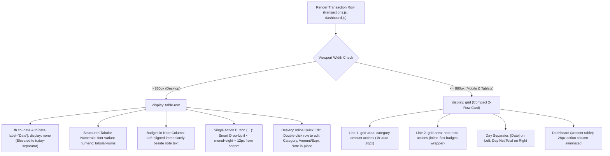
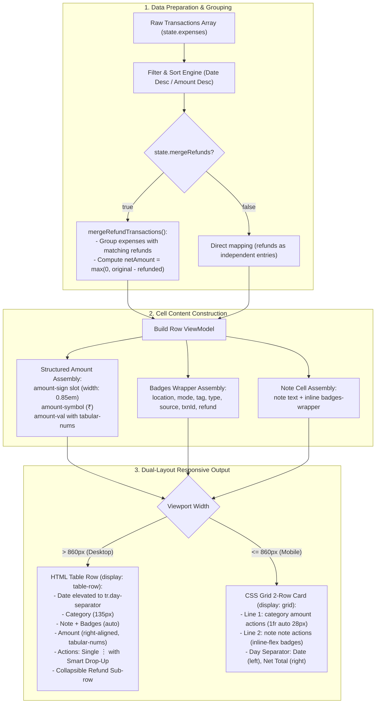

# Transaction Table UI Architecture & Layout Guidelines

## Overview
The Transaction Table UI renders all transaction lists (Recent Transactions on Dashboard, All Transactions, Selected Day Transactions, and Scheduled Transactions). To deliver a seamless user experience, the component uses a **dual-layout responsive strategy**:
1. **Desktop View (`> 860px`)**: Traditional HTML data table (`display: table-row`) with auto layout and cell truncation constraints.
2. **Mobile View (`<= 860px`)**: Compact card view using CSS Grid (`display: grid`) with 3-line grid template areas.





---

## 1. Desktop Layout Specifications (`> 860px`)

### 1.1 Column Alignment & Boundary Constraints
| Column | `data-label` | CSS Target | Target Width / Constraint | Text Alignment | Truncation / Overflow |
| :--- | :--- | :--- | :--- | :--- | :--- |
| **Date (in Day Separator)** | `Date & Location` / `Date` | Elevated to `tr.day-separator .day-date-label` (`th.col-date`, `td[data-label="Date"]` hidden via `display: none !important;`) | N/A | Left | `ellipsis` |
| **Category** | `Category` | `td[data-label="Category"]` | `width: 135px` | Left | `ellipsis` |
| **Note & Badges** | `Note` | `td[data-label="Note"]` | `width: auto` | Left | `white-space: normal`, `word-break: break-word` |
| **Mode (Badge on Desktop)** | `Mode` / `Txn Mode` | `.badge-mode` inside `.badges-wrapper` | `.badge-mode` (Desktop: in Note cell; `td[data-label="Mode"]` hidden on desktop) | Left | `white-space: nowrap` |
| **Amount** | `Amount` | `td[data-label="Amount"]` | `width: auto` (dynamic) | Right | `white-space: nowrap` |
| **Actions** | `Actions` | `td[data-label="Actions"]` | `width: 60px` (`padding-right: 16px`) | Right | `white-space: nowrap` |

*Note: The Date and Mode columns are hidden on desktop (`th.col-date`, `td[data-label="Date"]`, `th.col-mode`, `td[data-label="Mode"]` all set to `display: none !important;`). The date is elevated into the day separator (`tr.day-separator .day-date-label`), which is clickable to toggle date sorting (`window.toggleDateSort`). When sorted by Amount, a date badge (`dateBadge`) appears in Note. Location is displayed as a badge (`.badge-location`) in Note.*

### 1.2 Day Separator & Month Header Alignment
- **Day Separator**: On desktop, the empty cell before the Amount column spans `colspan="2"` (`Category` and `Note`). In `#all-table`, this follows the 1-column `col-batch-select` cell, placing the `day-separator-total` directly under the Amount column (column 4). In `#recent-table`, the `colspan="2"` cell is first, aligning `day-separator-total` under Amount (column 3).
- **Month Header**: Uses `<td colspan="2">${mName}</td>` followed by `<td class="month-header-total">` and trailing empty cell, aligning month net totals precisely under the Amount column.
- **Date Sorting**: Clicking on the day date in `.day-date-label` toggles date sort order (`window.toggleDateSort`). Clicking the Amount header cycles Amount Desc -> Amount Asc -> Date Desc.

### 1.3 Note Content & Badges Flexbox Alignment
- **Container**: `.note-content` (`display: flex; flex-wrap: wrap; align-items: center; gap: 4px 10px; width: 100%;`).
- **Desktop Badges**: On desktop (`> 860px`), `txnMode`, `location`, and (when sorted non-chronologically) `date` are rendered as badges in `.badges-wrapper` inside the `Note` column.
- **Desktop Badge Alignment**: On desktop (`min-width: 768px`), `.note-content` uses `justify-content: flex-start;` and `.badges-wrapper` uses `margin-left: 0; justify-content: flex-start;` so badges stay left-aligned immediately beside the note text.
- **Empty Note Handling**: When a transaction has no note text, the template renders `<span class="empty-dash"></span>`. To prevent flexbox `gap` from introducing an unwanted leading gap before badges, `.note-content > span:empty` and `.note-content > span.empty-dash` MUST have `display: none !important;`.

### 1.4 Amount & Expression Vertical Alignment Guidelines
- **Structured Amount Layout**: Amounts use structured HTML elements (`<span class="amount-main"><span class="amount-sign"></span><span class="amount-symbol">₹</span><span class="amount-val"></span></span>`) with `font-variant-numeric: tabular-nums`.
- **Fixed-Width Sign Slot**: `.amount-sign` has `width: 0.85em` and `text-align: right`, displaying `+`, `-`, or `&nbsp;` placeholder. This ensures `₹` symbols and digits line up 100% vertically across positive amounts, negative amounts, refunds, expenses, month totals, and day totals.
- **Dashboard Table Padding Alignment**: On Dashboard (`#recent-table`), `padding-right: 28px !important` is applied identically across `th.col-amount`, `td[data-label="Amount"]`, `.month-header-total`, and `.day-separator-total` so month header net totals and row amounts align to the exact same right boundary.

### 1.5 Actions Dropdown Menu & Smart Drop-Up Architecture
- **Single Action Button**: Table row actions render a single `⋮` button (`.action-dropdown-wrap`, `.action-dropdown-btn`) that opens a floating popup menu (`.action-dropdown-menu`).
- **Subrow Unique Keying**: In collapsible refund subrows, dropdown IDs MUST be uniquely keyed with `sub-${prefix}-${realIdx}-${itemIdx}` (`action-dropdown-sub-${prefix}-${realIdx}-${itemIdx}`) to avoid DOM ID collisions when multiple parent rows link to the same original expense/refund.
- **Smart Drop-Up Overflow Handling**: `window.toggleActionDropdown` measures available space below the button relative to viewport height and scroll container bounds (`.table-wrap`, `.card`, `.refund-collapsible-container`). If space below is insufficient (< menu height + 12px), it dynamically adds `.drop-up` (`bottom: calc(100% + 4px); top: auto;`), opening the menu upwards without container clipping.

### 1.6 Desktop Inline Quick Edit Architecture
To facilitate rapid inline modifications without the latency and visual disruption of a modal dialog, desktop users can edit transaction rows and linked refund subrow cards directly in-place:

- **Activation Trigger (`ondblclick`)**:
  - Double-clicking any transaction row (`tr#txn-row-${realIdx}`) or linked refund card (`.refund-item-card`) on desktop viewports (`window.innerWidth > 860`) engages inline edit mode (`state.inlineEditTxnIdx = realIdx`).
  - **Defensive Target Check**: The `ondblclick` handler contains `!event.target.closest('input, select, button, a, .action-dropdown-wrap')`, preventing accidental triggers when toggling batch checkboxes, opening action menus, or clicking links.
  - **Action Menu Policy**: On desktop with a mouse, Quick Edit is omitted from the action dropdown menu (`⋮`) to keep the menu compact and reserved for modal/destructive operations, relying on double-click. On iPad and touch devices (`html.is-ipad`, `@media (pointer: coarse)`), double-tapping is awkward on touch screens, so `⚡ Quick Edit` is automatically included in the row and subrow action dropdown menus (`.action-quick-edit.show-on-ipad`).
  - **Mobile Fallback**: If `startInlineEdit(realIdx)` is invoked when viewport is `<= 860px`, it gracefully falls back to opening the standard edit modal (`editEntry(realIdx)`).
- **Row Transformation (`tr.quick-editing`)**:
  - **Category**: Renders an inline `<select class="inline-edit-input inline-edit-select">` prefilled with existing categories from `state.categories` and active dataset categories.
  - **Note**: Renders an inline `<input type="text" class="inline-edit-input inline-edit-note-input">` prefilled with the current note, keeping location/mode/tag badges intact beneath.
  - **Amount / Expression**: Renders `<input type="text" class="inline-edit-input inline-edit-amount-input">` prefilled with `amountExpression` or numeric amount. The field is automatically focused with its contents selected for immediate overwrite or revision.
  - **Live Math Expression Preview**: As the user types arithmetic operations (e.g., `120+45*2`), a floating `<span class="inline-edit-preview-pill">` dynamically evaluates the expression and displays the calculated total (`= ₹210.00` or `-₹150.00` for refunds), displaying an inline warning if invalid syntax is detected.
  - **Inline Action Controls**: Replaces the `⋮` action button with:
    - `✓` (`.inline-btn-save`): Saves changes (<kbd>Enter</kbd> or click).
    - `✕` (`.inline-btn-cancel`): Discards changes (<kbd>Esc</kbd> or click).
- **Persistence & Invariant Preservation**:
  - Evaluates mathematical expressions using `evaluateExpression()`.
  - Strictly enforces negative sign for `Refund` and `Income` transaction types (`-Math.abs(parsedAmt)`).
  - Preserves all unedited fields (`date`, `currency`, `txnType`, `txnMode`, `location`, `tag`, `source`, `txnId`).
  - Persists changes to cloud storage via `saveYearCSV(year)`.
  - Re-renders table and applies a temporary background pulse to highlight the updated row.
- **Cancellation & Smart Click-Outside Behavior**:
  - Pressing <kbd>Esc</kbd> anywhere on the page (even when focus is outside the textboxes) or clicking `✕` calls `cancelInlineEdit()`, restoring the row without saving.
  - **Change Detection via `isInlineEditModified(realIdx)`**: Compares current values of Category, Amount/Expression, and Note against their initial states.
  - **Unedited Click-Outside**: Clicking anywhere outside the active row or refund card immediately cancels the inline edit and reverts to standard display mode.
  - **Edited Click-Outside Protection**: If any field was modified, outside clicks are safely ignored so work-in-progress is never lost accidentally.

---

## 2. Mobile Layout Specifications (`<= 860px`)

### 2.1 CSS Grid Card Template
In `@media (max-width: 860px)`, table rows (`tr:not(.month-header):not(.day-separator)`) transform into compact 2-row CSS Grid cards (the transaction date is elevated into the day separator row `tr.day-separator`):

- **Tables with Actions (`#all-table`, `#selected-day-tbody`)**:
```css
display: grid;
grid-template-areas:
    "category amount actions"
    "note note actions";
grid-template-columns: 1fr auto 28px;
gap: 3px 10px;
```

- **Dashboard Recent Transactions (`#recent-table`)**:
Since action buttons are hidden on mobile on the dashboard, `#recent-table` eliminates the 28px action column and right-side gap:
```css
display: grid;
grid-template-areas:
    "category amount"
    "note note";
grid-template-columns: 1fr auto;
gap: 3px 10px;
```
Month headers and day separators on `#recent-table` similarly use `grid-template-columns: 1fr auto !important;` with their dummy trailing empty cells hidden (`display: none !important;`). The day separator displays `[Date]` on the left and the day total on the right, styled with `margin-top: 14px` and `padding: 10px 4px 6px 4px` to provide clean visual breathing room above each day grouping.

- **Scheduled Transactions Table (`#scheduled-table`)**:
Retains metadata row for Next Run and Frequency:
```css
display: grid;
grid-template-areas:
    "category amount actions"
    "meta-left meta-right actions"
    "note note actions";
grid-template-columns: 1fr auto 28px;
gap: 2px 10px;
```

### 2.2 Grid Area Assignment & 2-Row Card Structure
- **Line 1 (`category amount [actions]`)**:
  - `Category`: `grid-area: category`, `font-weight: 600`, `ellipsis`.
  - `Amount`: `grid-area: amount`, `font-size: 1.05rem`, `font-weight: 700`, `justify-end`.
  - `Actions`: `grid-area: actions`, `align-self: start`, `justify-end` (hidden on `#recent-table`).
- **Line 2 (`note note [actions]`)**:
  - `Note`: `grid-area: note`, `align-self: start`.
  - **Structure**: Renders the note text directly followed by all badges:
    `[Note Text] [📍 Location Badge] [Txn Mode Badge] [Tag Badge] [Type Badge] [Source Badge] [Txn ID Badge] [Refund Badge]`
  - **Mobile Badge Alignment**: `.note-content` and `.badges-wrapper` use `justify-content: flex-start; margin-left: 0; display: inline-flex; gap: 4px; align-items: center;` so all badges follow immediately after the note text without being pushed to the far right.
  - **Location as Badge**: When present, location is rendered as `.badge-location` (`📍 LocationName`) in `.badges-wrapper`.
  - **Mode as Badge**: `.badge-mode` is styled as a rounded pill badge displayed directly in `.badges-wrapper`.
  - **Empty Note Hiding**: If both note text and badges are absent, `td.empty-note` has `display: none !important;` so Line 2 collapses cleanly.

---

## 3. Multi-Device Verification Matrix

Any changes to table styles (`webapp/css/components/tables.css`, `webapp/css/layout/responsive.css`) or row rendering JS (`webapp/js/ui/transactions.js`, `webapp/js/ui/dashboard.js`, `webapp/js/ui/chart_builders.js`, `webapp/js/utils/refund_helpers.js`) **MUST** be verified on:

1. **Desktop Browsers**:
   - Verify table column alignment, no horizontal scrollbars on standard displays, left-aligned badges, and proper `Mode` cell ellipsis.
2. **Android App (`spendbuddy-android-app`)**:
   - Verify mobile card grid layout in WebView, tap responsiveness for action buttons, left-aligned inline badges, and mode display.
3. **Mobile Browsers (iOS Safari / Android Chrome)**:
   - Verify touch scrolling, card gaps, and zero overflow on narrow screens (320px–420px).
4. **Collapsible / Split-Screen iPad View (600px – 860px)**:
   - Verify smooth breakpoint transition between desktop table and mobile grid cards without double wrapping or text collision.

---

## 4. Maintenance & Refactoring Rules

1. **Synchronized Markup Across Views**:
   - Always keep HTML structure identical across `transactions.js`, `dashboard.js`, and `chart_builders.js`:
     ```html
     <td data-label="Category">${escHtml(cat)}</td>
     <td data-label="Note" class="${!note && !badges ? 'empty-note' : ''}">
         <div class="note-content">
             <span class="${!note ? 'empty-dash' : ''}">${note ? escHtml(note) : ''}</span>
             ${badges ? `<div class="badges-wrapper">${badges}</div>` : ''}
         </div>
     </td>
     <td data-label="Mode"><span class="mode-cell">${escHtml(mode)}</span></td>
     ```
2. **Cache Bursting Mandatory**:
   - Whenever table CSS or JS is edited, increment the version parameters in `webapp/index.html` (`tables.css?v=N`, `responsive.css?v=N`, `app.js?v=N`).
